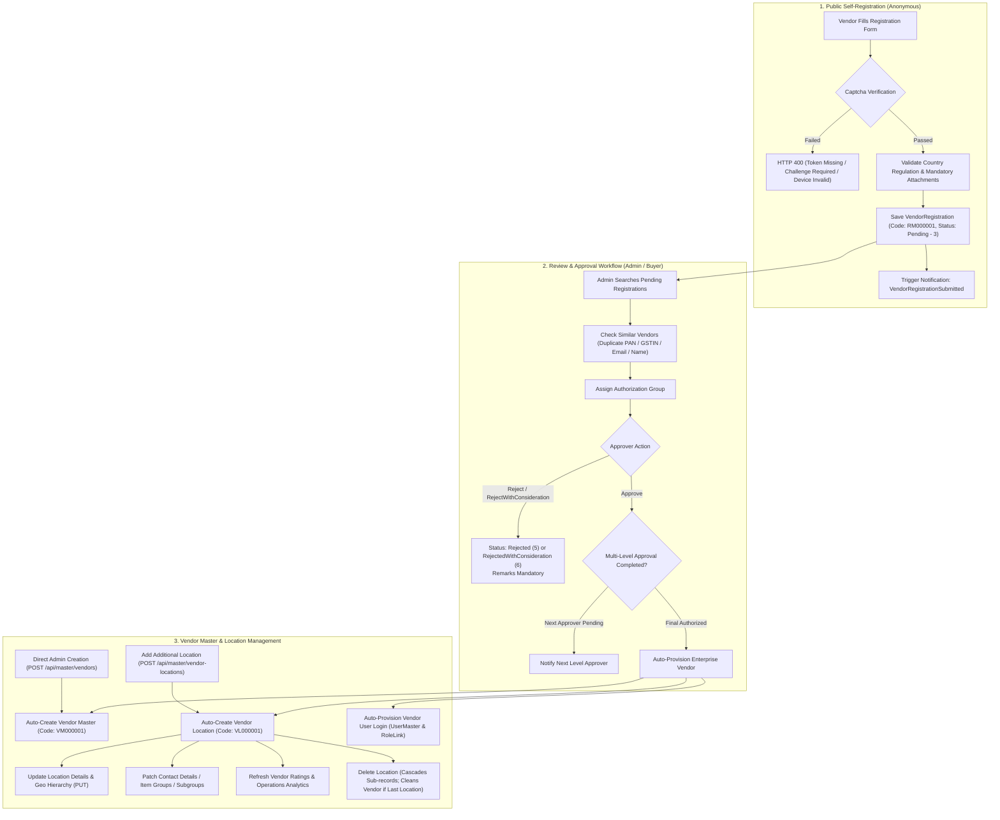
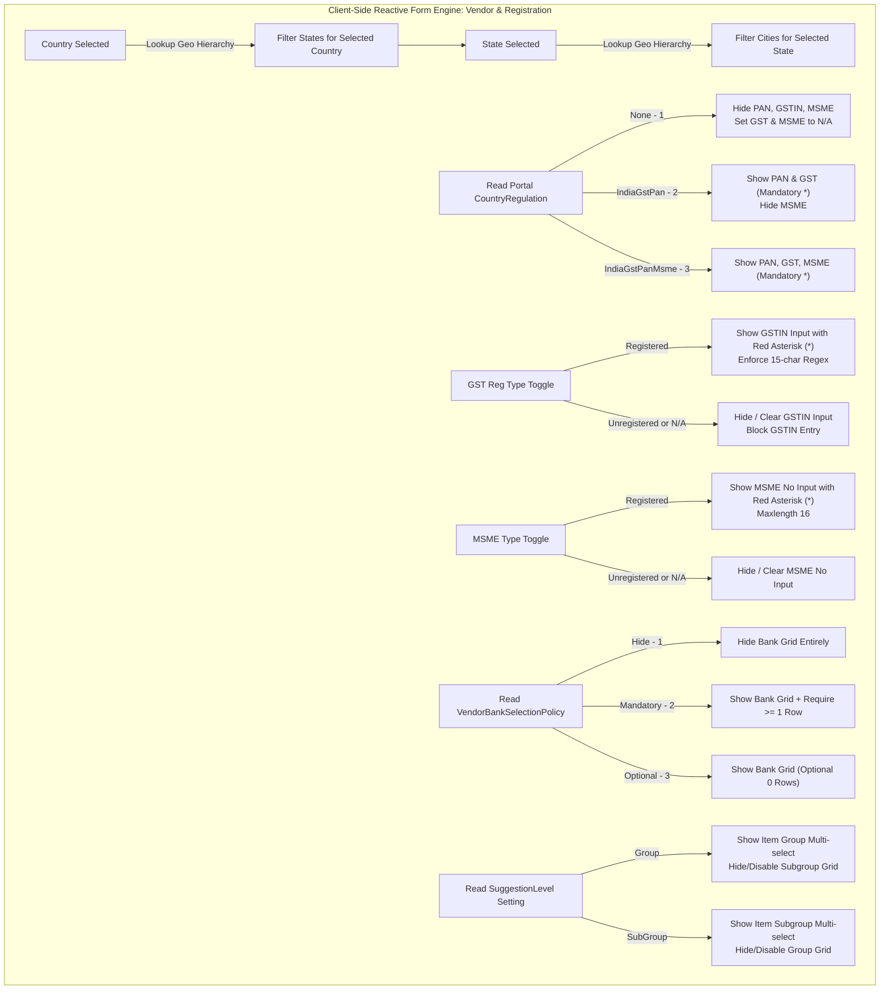

# Vendor Registration, Vendor Master & Vendor Location Master: API & UI Validation Test Specification

> **Target Application Master Forms & Routes:**
> - **Public Vendor Self-Registration Portal:** `/auth/vendor-registration` & `/vendor/registration`
> - **Vendor Registration Admin & Approval Console:** `/company/master/vendor-registration` & `/company/master/vendor-registration/review/:id`
> - **Vendor Master Search & Directory:** `/company/master/vendor`
> - **Vendor & Location Creation / Onboarding:** `/company/master/vendor/create` & `/company/master/vendor-locations/create`
> - **Vendor Location Profile & Edit Console:** `/company/master/vendor-locations/:locationId`
> - **Vendor Profile Snapshot & Operations Analytics:** `/company/master/vendor-locations/:locationId/snapshot`
> 
> **Corresponding Backend Controllers & Endpoints:**
> - **Vendor Registration API:** `eProcurement.Api.Controllers.Master.VendorRegistrationController` (`/api/master/vendor-registrations`)
> - **Vendor & Location API:** `eProcurement.Api.Controllers.Master.VendorController` (`/api/master/vendors`, `/api/master/vendor-locations`)
> 
> **Scope & Purpose:** Comprehensive, production-grade test specification covering **all possible test cases** for **Vendor Self-Registration**, **Vendor Master**, and **Vendor Location Master**, with deep coverage of **Portal Configurations** (Country Regulations, Bank Selection Policy, Contact Person Policy, Item Suggestion Levels, and Attachment Rules) across both **Part 1 (Backend REST API Validation)** and **Part 2 (Frontend User Interface & Parity Verification)**.

---

## 1. Architectural Lifecycle & Provisioning Flow

The vendor ecosystem in eProcurement follows an end-to-end lifecycle from anonymous public onboarding to approved enterprise vendor master records and multi-location management:



### 1.1 Structural Hierarchy & Code Generation

| Master Entity | Primary Key | Public / Business Code | Code Generation Prefix | Sequence Format | Constraints & Multiplicity |
| :--- | :--- | :--- | :---: | :---: | :--- |
| **Vendor Registration** | `Id` (int) | `Code` (string) | `"RM"` | `RM` + 6 digits (`RM000001`) | Single location per registration (`VendorRegLocationDetail.Count == 1`). |
| **Vendor Master** | `Id` (int) | `Code` (string) | `"VM"` | `VM` + 6 digits (`VM000001`) | Global entity; holds `VendorName`, `LegalName`, `BpTypeId`. |
| **Vendor Location Master** | `Id` (int) | `Code` (string) | `"VL"` | `VL` + 6 digits (`VL000001`) | Belongs to `VendorId`. Holds Address, GST, PAN, MSME, Bank, Contacts, Groups, Attachments. |

---

## 2. Portal Configurations Inventory & Impact Matrix

The following portal configuration parameters directly dictate the validation rules, visibility, and mandatory state of fields in Vendor Registration, Vendor Master, and Vendor Location Master:

| Portal Configuration Key | Data Type / Enum | Configuration Values | Backend Enforcement Rule | Frontend UI Impact |
| :--- | :--- | :--- | :--- | :--- |
| `CountryRegulationId` | `CountryRegulationEnum` | `1` = None<br/>`2` = IndiaGstPan<br/>`3` = IndiaGstPanMsme | Enforces tax and statutory identifier rules per location country. | Dynamically shows/hides PAN, GST, and MSME sections and adjusts required asterisks (`*`). |
| `DefaultCountryId` | `int?` | Country ID (e.g., `1` for India) | If location country matches `DefaultCountryId`, full regulation rules apply. If mismatch, mandatory enforcement is relaxed to prevent cross-border blocking. | Defaults the Country dropdown; toggles domestic vs international form layouts. |
| `VendorBankSelectionPolicyId` | `SelectionPolicyEnum` | `1` = Hide<br/>`2` = Mandatory<br/>`3` = Optional | • **Hide (1):** Errors if `BankDetails.Count > 0`.<br/>• **Mandatory (2):** Errors if `BankDetails.Count == 0`.<br/>• **Optional (3):** Allowed, validated if present. | • **Hide:** Bank Details section hidden.<br/>• **Mandatory:** Bank grid shows red asterisk (`*`), requires $\ge 1$ row.<br/>• **Optional:** Grid present, 0 rows allowed. |
| `VendorCpSelectionPolicyId` | `SelectionPolicyEnum` | `1` = Hide<br/>`2` = Mandatory<br/>`3` = Optional | • **Hide (1):** Errors if `ContactPersons.Count > 0`.<br/>• **Mandatory (2):** Errors if `ContactPersons.Count == 0`.<br/>• **Optional (3):** Allowed, validated if present. | • **Hide:** Contact Persons section hidden.<br/>• **Mandatory:** Contact grid requires $\ge 1$ person.<br/>• **Optional:** Contact grid optional. |
| `IsVendorAttachmentRequired` | `bool` | `true` / `false` | • **false:** Attachments rejected (`Vendor attachments are not allowed`).<br/>• **true:** Attachments allowed. In Vendor Registration, all active mandatory attachments (`GetMandatoryAttachment`) **must** be uploaded. | • **false:** Attachment upload component hidden.<br/>• **true:** Attachment upload tab visible; mandatory documents marked with red badge (`* Mandatory`). |
| `DefaultVendorItemSuggestionLevel` | `string?` | `"Group"` vs `"SubGroup"` | • **"Group":** Rejects item subgroup mappings (`Item Subgroup mapping is not allowed`).<br/>• **"SubGroup":** Rejects item group mappings (`Item Group mapping is not allowed`). | Dropdown or tab in UI locks mapping to only Groups or only Subgroups; disables the opposing selector. |
| `IsVendorProfileEditable` | `bool` | `true` / `false` | Controls whether vendor users can edit profile fields post-approval. | Locks vendor self-service profile page into read-only mode when `false`. |
| `VendorRatingLookbackPeriod` | `short?` | Months (e.g., `3`, `6`, `12`) | Governs performance aggregation time window. | Sets default filter tab in Vendor Operations & Rating dashboard. |

### 2.1 Detailed Country Regulation Matrix

| Regulation Enum | PAN No. Rule | GST Registration Type Rule | GSTIN No. Rule | MSME Type Rule | MSME No. Rule |
| :--- | :--- | :--- | :--- | :--- | :--- |
| **`None (1)`** | Must be **empty / null**. | Must be **`NotApplicable (3)`**. | Must be **empty / null**. | Must be **`NotApplicable (3)`**. | Must be **empty / null**. |
| **`IndiaGstPan (2)`** | **Mandatory** ($\le 10$ chars). | **Mandatory** (`Registered` or `Unregistered`; cannot be `NotApplicable`). | **Mandatory** if `Registered`; must be **empty** if `Unregistered`. | Must be **`NotApplicable (3)`**. | Must be **empty / null**. |
| **`IndiaGstPanMsme (3)`** | **Mandatory** ($\le 10$ chars). | **Mandatory** (`Registered` or `Unregistered`; cannot be `NotApplicable`). | **Mandatory** if `Registered`; must be **empty** if `Unregistered`. | **Mandatory** (`Registered` or `Unregistered`; cannot be `NotApplicable`). | **Mandatory** if `Registered` ($\le 16$ chars); must be **empty** if `Unregistered`. |

---

# Part 1: Backend API Test Specifications

---

## 3. Vendor Registration API Test Cases (`/api/master/vendor-registrations`)

### 3.1 Vendor Registration Endpoints Under Test

| HTTP Method | Route | Description | Required Authorization / Headers |
| :--- | :--- | :--- | :--- |
| `POST` | `/api/master/vendor-registrations` | Public Vendor Self-Registration | `[AllowAnonymous]`, `X-Captcha-Attempt-Device`, `X-Request-Source`, `CaptchaToken` |
| `GET` | `/api/master/vendor-registrations` | Paged Search & List Registrations | `[Authorize]` |
| `GET` | `/api/master/vendor-registrations/{publicId:Guid}` | Get Registration Details by Public GUID | `[AllowAnonymous]` |
| `PUT` | `/api/master/vendor-registrations/{id:int}` | Update Registration Details | `[Authorize]` |
| `PUT` | `/api/master/vendor-registrations/assign-approvers` | Assign Authorization Group to Pending Registrations | `[Authorize]` |
| `GET` | `/api/master/vendor-registrations/approvals` | Paged List of Registrations Pending User Approval | `[Authorize]` |
| `GET` | `/api/master/vendor-registrations/{id:int}/similar-vendors` | Duplicate Vendor Match Detection (PAN/GSTIN/Name) | `[Authorize]` |
| `POST` | `/api/master/vendor-registrations/approval` | Approve, Reject, or Reject With Consideration | `[Authorize]` |

### 3.2 Vendor Registration API Test Matrix

| Test Case ID | Endpoint & Scenario | Payload / Condition | Expected Status | Expected Error / Response Body | Code Rule Reference |
| :--- | :--- | :--- | :---: | :--- | :--- |
| `API-VRG-001` | `POST /api/master/vendor-registrations` | Missing `VendorName`: `{"vendorName": "", ...}` | `400 Bad Request` | `"VendorName is required"` | [VendorRegistrationModelValidator.cs:16](file:///c:/Users/shekh/Downloads/Telegram%20Desktop/eProcurement-Develop%20(5)/eProcurement-Develop/Api/ModelValidators/Master/VendorRegistrationModelValidator.cs#L16) |
| `API-VRG-002` | `POST /api/master/vendor-registrations` | `VendorName` exceeds 150 chars: String with 151 characters | `400 Bad Request` | `"VendorName must be between 1 and 150 characters"` | [VendorRegistrationModelValidator.cs:18](file:///c:/Users/shekh/Downloads/Telegram%20Desktop/eProcurement-Develop%20(5)/eProcurement-Develop/Api/ModelValidators/Master/VendorRegistrationModelValidator.cs#L18) |
| `API-VRG-003` | `POST /api/master/vendor-registrations` | Missing `LegalName`: `{"legalName": "", ...}` | `400 Bad Request` | `"LegalName is required"` | [VendorRegistrationModelValidator.cs:22](file:///c:/Users/shekh/Downloads/Telegram%20Desktop/eProcurement-Develop%20(5)/eProcurement-Develop/Api/ModelValidators/Master/VendorRegistrationModelValidator.cs#L22) |
| `API-VRG-004` | `POST /api/master/vendor-registrations` | Missing `BpTypeId`: `{"bpTypeId": 0, ...}` | `400 Bad Request` | `"BpTypeId is required"` | [VendorRegistrationModelValidator.cs:28](file:///c:/Users/shekh/Downloads/Telegram%20Desktop/eProcurement-Develop%20(5)/eProcurement-Develop/Api/ModelValidators/Master/VendorRegistrationModelValidator.cs#L28) |
| `API-VRG-005` | `POST /api/master/vendor-registrations` | Missing `VendorRegLocationDetail`: Empty array `[]` | `400 Bad Request` | `"Provide at least one Registration Location Detail."` | [VendorRegistrationModelValidator.cs:35](file:///c:/Users/shekh/Downloads/Telegram%20Desktop/eProcurement-Develop%20(5)/eProcurement-Develop/Api/ModelValidators/Master/VendorRegistrationModelValidator.cs#L35) |
| `API-VRG-006` | `POST /api/master/vendor-registrations` | Multiple locations in registration: Array with 2 locations | `400 Bad Request` | `"Multiple vendor location is not allowed."` | [VendorRegistrationModelValidator.cs:40](file:///c:/Users/shekh/Downloads/Telegram%20Desktop/eProcurement-Develop%20(5)/eProcurement-Develop/Api/ModelValidators/Master/VendorRegistrationModelValidator.cs#L40) |
| `API-VRG-007` | `POST /api/master/vendor-registrations` | Missing `AddressLine1` in location | `400 Bad Request` | `"AddressLine1 is required"` | [VendorRegistrationModelValidator.cs:45](file:///c:/Users/shekh/Downloads/Telegram%20Desktop/eProcurement-Develop%20(5)/eProcurement-Develop/Api/ModelValidators/Master/VendorRegistrationModelValidator.cs#L45) |
| `API-VRG-008` | `POST /api/master/vendor-registrations` | Missing `Email` or invalid email regex format (e.g. `"test@com"`) | `400 Bad Request` | `"Email is required"` / `"Invalid email format"` | [VendorRegistrationModelValidator.cs:64-70](file:///c:/Users/shekh/Downloads/Telegram%20Desktop/eProcurement-Develop%20(5)/eProcurement-Develop/Api/ModelValidators/Master/VendorRegistrationModelValidator.cs#L64-L70) |
| `API-VRG-009` | `POST /api/master/vendor-registrations` | Inactive or non-existent `CountryId` | `400 Bad Request` | `"Country is inactive or does not exists."` | [VendorRegistrationCoreService.cs:95](file:///c:/Users/shekh/Downloads/Telegram%20Desktop/eProcurement-Develop%20(5)/eProcurement-Develop/Core/Services/Master/VendorRegistrationCoreService.cs#L95) |
| `API-VRG-010` | `POST /api/master/vendor-registrations` | `StateId` does not belong to selected `CountryId` | `400 Bad Request` | `"State is inactive or does not belong to the selected country."` | [VendorRegistrationCoreService.cs:100](file:///c:/Users/shekh/Downloads/Telegram%20Desktop/eProcurement-Develop%20(5)/eProcurement-Develop/Core/Services/Master/VendorRegistrationCoreService.cs#L100) |
| `API-VRG-011` | `POST /api/master/vendor-registrations` | `CityId` does not belong to selected `StateId` | `400 Bad Request` | `"City is inactive or does not belong to the selected state."` | [VendorRegistrationCoreService.cs:106](file:///c:/Users/shekh/Downloads/Telegram%20Desktop/eProcurement-Develop%20(5)/eProcurement-Develop/Core/Services/Master/VendorRegistrationCoreService.cs#L106) |
| `API-VRG-012` | `POST /api/master/vendor-registrations` | Inactive or invalid `VendorCategoryId` | `400 Bad Request` | `"Vendor Category is inactive or does not exist."` | [VendorRegistrationCoreService.cs:111](file:///c:/Users/shekh/Downloads/Telegram%20Desktop/eProcurement-Develop%20(5)/eProcurement-Develop/Core/Services/Master/VendorRegistrationCoreService.cs#L111) |
| `API-VRG-013` | `POST /api/master/vendor-registrations` | Inactive or invalid `RegionId` | `400 Bad Request` | `"Region is inactive or does not exist."` | [VendorRegistrationCoreService.cs:116](file:///c:/Users/shekh/Downloads/Telegram%20Desktop/eProcurement-Develop%20(5)/eProcurement-Develop/Core/Services/Master/VendorRegistrationCoreService.cs#L116) |
| `API-VRG-014` | `POST /api/master/vendor-registrations` | Portal setting `SuggestionLevel = "Group"`, but location submits `ItemSubgroups: [1]` | `400 Bad Request` | `"Item Subgroup mapping is not allowed when suggestion level is set to Group."` | [VendorRegistrationCoreService.cs:58](file:///c:/Users/shekh/Downloads/Telegram%20Desktop/eProcurement-Develop%20(5)/eProcurement-Develop/Core/Services/Master/VendorRegistrationCoreService.cs#L58) |
| `API-VRG-015` | `POST /api/master/vendor-registrations` | Portal setting `SuggestionLevel = "SubGroup"`, but location submits `ItemGroups: [1]` | `400 Bad Request` | `"Item Group mapping is not allowed when suggestion level is set to Subgroup."` | [VendorRegistrationCoreService.cs:63](file:///c:/Users/shekh/Downloads/Telegram%20Desktop/eProcurement-Develop%20(5)/eProcurement-Develop/Core/Services/Master/VendorRegistrationCoreService.cs#L63) |
| `API-VRG-016` | `POST /api/master/vendor-registrations` | Portal setting `CountryRegulation = IndiaGstPanMsme (3)`, but `PanNo` is omitted | `400 Bad Request` | `"PAN is required for the selected country regulation."` | [VendorRegistrationCoreService.cs:350](file:///c:/Users/shekh/Downloads/Telegram%20Desktop/eProcurement-Develop%20(5)/eProcurement-Develop/Core/Services/Master/VendorRegistrationCoreService.cs#L350) |
| `API-VRG-017` | `POST /api/master/vendor-registrations` | Portal setting `CountryRegulation = IndiaGstPanMsme (3)`, `GstRegTypeId = Registered (1)`, but `GstinNo` is blank | `400 Bad Request` | `"GSTIN is required for the selected country regulation."` | [VendorRegistrationCoreService.cs:365](file:///c:/Users/shekh/Downloads/Telegram%20Desktop/eProcurement-Develop%20(5)/eProcurement-Develop/Core/Services/Master/VendorRegistrationCoreService.cs#L365) |
| `API-VRG-018` | `POST /api/master/vendor-registrations` | Portal setting `CountryRegulation = IndiaGstPanMsme (3)`, `GstRegTypeId = Unregistered (2)`, but `GstinNo` has value | `400 Bad Request` | `"GSTIN must be empty when GST registration type is unregistered or not applicable."` | [VendorRegistrationCoreService.cs:372](file:///c:/Users/shekh/Downloads/Telegram%20Desktop/eProcurement-Develop%20(5)/eProcurement-Develop/Core/Services/Master/VendorRegistrationCoreService.cs#L372) |
| `API-VRG-019` | `POST /api/master/vendor-registrations` | Portal setting `CountryRegulation = IndiaGstPanMsme (3)`, `MsmeTypeId = Registered (1)`, but `MsmeNo` is blank | `400 Bad Request` | `"MSME number is required when MSME type is registered."` | [VendorRegistrationCoreService.cs:329](file:///c:/Users/shekh/Downloads/Telegram%20Desktop/eProcurement-Develop%20(5)/eProcurement-Develop/Core/Services/Master/VendorRegistrationCoreService.cs#L329) |
| `API-VRG-020` | `POST /api/master/vendor-registrations` | Portal setting `CountryRegulation = None (1)`, but vendor submits PAN / GSTIN / MSME | `400 Bad Request` | `"PAN must is not allowed when country regulation is None."` | [VendorRegistrationCoreService.cs:267](file:///c:/Users/shekh/Downloads/Telegram%20Desktop/eProcurement-Develop%20(5)/eProcurement-Develop/Core/Services/Master/VendorRegistrationCoreService.cs#L267) |
| `API-VRG-021` | `POST /api/master/vendor-registrations` | Missing Mandatory Vendor Attachments defined in system | `400 Bad Request` | `"These mandatory attachments are missing: {attachmentNames}"` | [VendorRegistrationCoreService.cs:205](file:///c:/Users/shekh/Downloads/Telegram%20Desktop/eProcurement-Develop%20(5)/eProcurement-Develop/Core/Services/Master/VendorRegistrationCoreService.cs#L205) |
| `API-VRG-022` | `POST /api/master/vendor-registrations` | Duplicate Contact No in location contact persons list | `400 Bad Request` | `"Duplicate Contact No is not allowed."` | [VendorRegistrationModelValidator.cs:195](file:///c:/Users/shekh/Downloads/Telegram%20Desktop/eProcurement-Develop%20(5)/eProcurement-Develop/Api/ModelValidators/Master/VendorRegistrationModelValidator.cs#L195) |
| `API-VRG-023` | `POST /api/master/vendor-registrations` | Duplicate Email in location contact persons list | `400 Bad Request` | `"Duplicate Email is not allowed."` | [VendorRegistrationModelValidator.cs:207](file:///c:/Users/shekh/Downloads/Telegram%20Desktop/eProcurement-Develop%20(5)/eProcurement-Develop/Api/ModelValidators/Master/VendorRegistrationModelValidator.cs#L207) |
| `API-VRG-024` | `POST /api/master/vendor-registrations` | Duplicate Bank Account Number in bank details list | `400 Bad Request` | `"Duplicate Account No. not allowed."` | [VendorRegistrationModelValidator.cs:228](file:///c:/Users/shekh/Downloads/Telegram%20Desktop/eProcurement-Develop%20(5)/eProcurement-Develop/Api/ModelValidators/Master/VendorRegistrationModelValidator.cs#L228) |
| `API-VRG-025` | `POST /api/master/vendor-registrations` | Missing Captcha Token or invalid Device ID header | `400 Bad Request` | `"Captcha token is required."` / `"Device identifier is required."` | [VendorRegistrationController.cs:56-65](file:///c:/Users/shekh/Downloads/Telegram%20Desktop/eProcurement-Develop%20(5)/eProcurement-Develop/Api/Controllers/Master/VendorRegistrationController.cs#L56-L65) |
| `API-VRG-026` | `POST /api/master/vendor-registrations` | Valid payload with verified captcha | `200 OK` | `{"isSuccess": true, "responseType": 1, "data": {"id": 1, "code": "RM000001", "name": "Tata Motors"}}` | [VendorRegistrationService.cs:99-120](file:///c:/Users/shekh/Downloads/Telegram%20Desktop/eProcurement-Develop%20(5)/eProcurement-Develop/Api/Services/Master/VendorRegistrationService.cs#L99-L120) |
| `API-VRG-027` | `PUT /api/master/vendor-registrations/assign-approvers` | Assign Auth Group to registration already in `Approved (4)` status | `400 Bad Request` | `"Authorization Group can only be assigned to Vendor Registrations in Pending status."` | [VendorRegistrationCoreService.cs:397](file:///c:/Users/shekh/Downloads/Telegram%20Desktop/eProcurement-Develop%20(5)/eProcurement-Develop/Core/Services/Master/VendorRegistrationCoreService.cs#L397) |
| `API-VRG-028` | `POST /api/master/vendor-registrations/approval` | Action = `Rejected (5)` or `RejectedWithConsideration (6)`, but `remarks` is empty | `400 Bad Request` | `"Remarks are mandatory when action is Reject or Reject with Consideration."` | [VendorRegistrationApprovalActionModelValidator.cs:32](file:///c:/Users/shekh/Downloads/Telegram%20Desktop/eProcurement-Develop%20(5)/eProcurement-Develop/Api/ModelValidators/Master/VendorRegistrationApprovalActionModelValidator.cs#L32) |
| `API-VRG-029` | `POST /api/master/vendor-registrations/approval` | Action = `Approved (4)` on final approval level | `200 OK` | Automatically creates Vendor Master (`VM000001`), Location (`VL000001`), User Login, and sets Registration status to `Approved`. | [VendorRegistrationService.cs:995-1001](file:///c:/Users/shekh/Downloads/Telegram%20Desktop/eProcurement-Develop%20(5)/eProcurement-Develop/Api/Services/Master/VendorRegistrationService.cs#L995-L1001) |

---

## 4. Vendor Master & Location API Test Cases (`/api/master/vendors`, `/api/master/vendor-locations`)

### 4.1 Vendor & Location Endpoints Under Test

| HTTP Method | Route | Description | Required Authorization |
| :--- | :--- | :--- | :--- |
| `POST` | `/api/master/vendors` | Direct Enterprise Vendor + Locations Creation | `[Authorize]`, `[VendorRestriction]` |
| `POST` | `/api/master/vendor-locations` | Add New Location to Existing Vendor | `[Authorize]`, `[VendorRestriction]` |
| `PUT` | `/api/master/vendor-locations/{locationId:int}` | Update Vendor Location & Vendor Header Details | `[Authorize]`, `[VendorRestriction]` |
| `GET` | `/api/master/vendor-locations` | Paged Search & List Vendor Locations | `[Authorize]`, `[VendorRestriction]` |
| `GET` | `/api/master/vendor-locations/{locationId:int}` | Get Complete Vendor Location by ID | `[Authorize]`, `[VendorRestriction]` |
| `GET` | `/api/master/vendor-master/Get` | Lookup Vendors for Dropdowns | `[Authorize]` |
| `GET` | `/api/master/vendor-master/locations/Get` | Lookup Locations for Specific Vendor (`vendorId`) | `[Authorize]` |
| `GET` | `/api/master/vendor-master/locations/contact-persons/get` | Get Contact Persons for Location (`vendorLocationId`) | `[Authorize]` |
| `DELETE` | `/api/master/vendor-master/locations/{locationId:int}` | Delete Vendor Location | `[Authorize]`, `[VendorRestriction]` |
| `PATCH` | `/api/master/vendor-locations/{vendorLocationId:int}/contact-detail` | Quick Patch Location Contact & Website | `[Authorize]`, `[VendorRestriction]` |
| `PATCH` | `/api/master/vendors/vendor-locations/{vendorLocationId:int}/item-groups` | Replace Mapped Item Groups | `[Authorize]`, `[VendorRestriction]`, `[Rights(FormEnum.VendorRegistration, RightsEnum.Update)]` |
| `PATCH` | `/api/master/vendors/vendor-locations/{vendorLocationId:int}/item-subgroups` | Replace Mapped Item Subgroups | `[Authorize]`, `[VendorRestriction]`, `[Rights(FormEnum.VendorRegistration, RightsEnum.Update)]` |
| `POST` | `/api/master/vendor-rating/refresh/{vendorLocationId:int}` | Trigger Vendor Performance Rating Recomputation | `[Authorize]`, `[VendorRestriction]` |
| `GET` | `/api/vendors/get-operations-count/{vendorLocationId:int}` | Fetch Operations Metrics (RFQ, Quote, PO spend) | `[Authorize]`, `[VendorRestriction]` |
| `POST` | `/api/master/vendor-recommendation` | AI / Multi-Factor Vendor Recommendation | `[Authorize]`, `[VendorRestriction]` |

### 4.2 Vendor Master & Location API Test Matrix

| Test Case ID | Endpoint & Method | Scenario / Payload Input | Expected Status | Expected Error / Response Body | Code Rule Reference |
| :--- | :--- | :--- | :---: | :--- | :--- |
| `API-VND-001` | `POST /api/master/vendors` | Missing `VendorName`: `{"vendorName": "", ...}` | `400 Bad Request` | `"VendorName is required"` | [VendorModelValidator.cs:15](file:///c:/Users/shekh/Downloads/Telegram%20Desktop/eProcurement-Develop%20(5)/eProcurement-Develop/Api/ModelValidators/Master/VendorModelValidator.cs#L15) |
| `API-VND-002` | `POST /api/master/vendors` | Missing `VendorLocationDetail`: `{"vendorName": "ABC", "vendorLocationDetail": []}` | `400 Bad Request` | `"VendorLocationDetail is required"` | [VendorModelValidator.cs:26](file:///c:/Users/shekh/Downloads/Telegram%20Desktop/eProcurement-Develop%20(5)/eProcurement-Develop/Api/ModelValidators/Master/VendorModelValidator.cs#L26) |
| `API-VND-003` | `POST /api/master/vendors` | Portal `IsVendorAttachmentRequired = false`, but location sends `VendorLocationAttachmentDetail: [{...}]` | `400 Bad Request` | `"Vendor attachments are not allowed according to the portal configuration."` | [VendorCoreService.cs:72](file:///c:/Users/shekh/Downloads/Telegram%20Desktop/eProcurement-Develop%20(5)/eProcurement-Develop/Core/Services/Master/VendorCoreService.cs#L72) |
| `API-VND-004` | `POST /api/master/vendors` | Portal `VendorBankSelectionPolicyId = Hide (1)`, but location sends Bank Details | `400 Bad Request` | `"Bank details are not allowed according to the portal configuration."` | [VendorCoreService.cs:104](file:///c:/Users/shekh/Downloads/Telegram%20Desktop/eProcurement-Develop%20(5)/eProcurement-Develop/Core/Services/Master/VendorCoreService.cs#L104) |
| `API-VND-005` | `POST /api/master/vendors` | Portal `VendorBankSelectionPolicyId = Mandatory (2)`, but location sends 0 Bank Details | `400 Bad Request` | `"At least one bank detail is required as per portal settings."` | [VendorCoreService.cs:110](file:///c:/Users/shekh/Downloads/Telegram%20Desktop/eProcurement-Develop%20(5)/eProcurement-Develop/Core/Services/Master/VendorCoreService.cs#L110) |
| `API-VND-006` | `POST /api/master/vendors` | Portal `VendorCpSelectionPolicyId = Hide (1)`, but location sends Contact Persons | `400 Bad Request` | `"Contact person details are not allowed according to the portal configuration."` | [VendorCoreService.cs:123](file:///c:/Users/shekh/Downloads/Telegram%20Desktop/eProcurement-Develop%20(5)/eProcurement-Develop/Core/Services/Master/VendorCoreService.cs#L123) |
| `API-VND-007` | `POST /api/master/vendors` | Portal `VendorCpSelectionPolicyId = Mandatory (2)`, but location sends 0 Contact Persons | `400 Bad Request` | `"At least one contact person is required as per portal settings."` | [VendorCoreService.cs:129](file:///c:/Users/shekh/Downloads/Telegram%20Desktop/eProcurement-Develop%20(5)/eProcurement-Develop/Core/Services/Master/VendorCoreService.cs#L129) |
| `API-VND-008` | `POST /api/master/vendors` | Portal `CountryRegulation = IndiaGstPan (2)`, but `PanNo` is missing | `400 Bad Request` | `"PAN is required for the selected country regulation."` | [VendorCoreService.cs:409](file:///c:/Users/shekh/Downloads/Telegram%20Desktop/eProcurement-Develop%20(5)/eProcurement-Develop/Core/Services/Master/VendorCoreService.cs#L409) |
| `API-VND-009` | `POST /api/master/vendors` | Portal `CountryRegulation = IndiaGstPan (2)`, `GstRegTypeId = Registered`, but `GstinNo` missing | `400 Bad Request` | `"GSTIN is required for the selected country regulation."` | [VendorCoreService.cs:432](file:///c:/Users/shekh/Downloads/Telegram%20Desktop/eProcurement-Develop%20(5)/eProcurement-Develop/Core/Services/Master/VendorCoreService.cs#L432) |
| `API-VND-010` | `POST /api/master/vendors` | Location Contact Person with `StatusId = Active (1)` but non-empty `StatusRemarks` | `400 Bad Request` | `"Status remarks must be empty when status is Active."` | [VendorModelValidator.cs:192](file:///c:/Users/shekh/Downloads/Telegram%20Desktop/eProcurement-Develop%20(5)/eProcurement-Develop/Api/ModelValidators/Master/VendorModelValidator.cs#L192) |
| `API-VND-011` | `POST /api/master/vendors` | Location Contact Person with `StatusId = Inactive (2)` but empty `StatusRemarks` | `400 Bad Request` | `"Status remarks are required when status is Inactive."` | [VendorModelValidator.cs:197](file:///c:/Users/shekh/Downloads/Telegram%20Desktop/eProcurement-Develop%20(5)/eProcurement-Develop/Api/ModelValidators/Master/VendorModelValidator.cs#L197) |
| `API-VND-012` | `POST /api/master/vendors` | Location sends duplicate `ItemGroupId`: `[{"itemGroupId": 1}, {"itemGroupId": 1}]` | `400 Bad Request` | `"Duplicate Group mapping not allowed."` | [VendorModelValidator.cs:262](file:///c:/Users/shekh/Downloads/Telegram%20Desktop/eProcurement-Develop%20(5)/eProcurement-Develop/Api/ModelValidators/Master/VendorModelValidator.cs#L262) |
| `API-VND-013` | `POST /api/master/vendors` | Location sends duplicate `ItemSubgroupId`: `[{"itemSubgroupId": 2}, {"itemSubgroupId": 2}]` | `400 Bad Request` | `"Duplicate Subgroup mapping not allowed."` | [VendorModelValidator.cs:267](file:///c:/Users/shekh/Downloads/Telegram%20Desktop/eProcurement-Develop%20(5)/eProcurement-Develop/Api/ModelValidators/Master/VendorModelValidator.cs#L267) |
| `API-VND-014` | `POST /api/master/vendors` | Location sends duplicate `VendorAttachmentId` | `400 Bad Request` | `"Duplicate Vendor Attachment not allowed."` | [VendorModelValidator.cs:272](file:///c:/Users/shekh/Downloads/Telegram%20Desktop/eProcurement-Develop%20(5)/eProcurement-Develop/Api/ModelValidators/Master/VendorModelValidator.cs#L272) |
| `API-VND-015` | `POST /api/master/vendors` | Location sends duplicate `AttachmentId` (Document) | `400 Bad Request` | `"Duplicate Document Attachment not allowed."` | [VendorModelValidator.cs:277](file:///c:/Users/shekh/Downloads/Telegram%20Desktop/eProcurement-Develop%20(5)/eProcurement-Develop/Api/ModelValidators/Master/VendorModelValidator.cs#L277) |
| `API-VND-016` | `POST /api/master/vendors` | Attachment ID is already attached to another document | `400 Bad Request` | `"These attachments are already linked to another document and cannot be reused: ..."` | [VendorCoreService.cs:257](file:///c:/Users/shekh/Downloads/Telegram%20Desktop/eProcurement-Develop%20(5)/eProcurement-Develop/Core/Services/Master/VendorCoreService.cs#L257) |
| `API-VND-017` | `POST /api/master/vendors` | Valid multi-location vendor creation | `200 OK` | `{"isSuccess": true, "responseType": 1, "data": {"id": 1, "code": "VM000001", "name": "BHEL"}}` | [VendorService.cs:61-90](file:///c:/Users/shekh/Downloads/Telegram%20Desktop/eProcurement-Develop%20(5)/eProcurement-Develop/Api/Services/Master/VendorService.cs#L61-L90) |
| `API-VND-018` | `POST /api/master/vendor-locations` | Missing `VendorId`: `{"vendorId": 0, ...}` | `400 Bad Request` | `"VendorId is required"` | [VendorModelValidator.cs:32](file:///c:/Users/shekh/Downloads/Telegram%20Desktop/eProcurement-Develop%20(5)/eProcurement-Develop/Api/ModelValidators/Master/VendorModelValidator.cs#L32) |
| `API-VND-019` | `POST /api/master/vendor-locations` | Valid location for existing Vendor | `200 OK` | Generates next Location Code (`VL000002`), links to `vendorId` | [VendorService.cs:223-262](file:///c:/Users/shekh/Downloads/Telegram%20Desktop/eProcurement-Develop%20(5)/eProcurement-Develop/Api/Services/Master/VendorService.cs#L223-L262) |
| `API-VND-020` | `PUT /api/master/vendor-locations/{locationId}` | Missing concurrency token `lastModifiedDate` | `400 Bad Request` | Concurrency check failure / missing token | [VendorModel.cs:53](file:///c:/Users/shekh/Downloads/Telegram%20Desktop/eProcurement-Develop%20(5)/eProcurement-Develop/Api/Models/Master/VendorModel.cs#L53) |
| `API-VND-021` | `PUT /api/master/vendor-locations/{locationId}` | Valid update with fresh `lastModifiedDate` | `200 OK` | `{"isSuccess": true, "responseType": 2, "data": {"id": 1, "code": "VL000001"}}` | [VendorService.cs:357-452](file:///c:/Users/shekh/Downloads/Telegram%20Desktop/eProcurement-Develop%20(5)/eProcurement-Develop/Api/Services/Master/VendorService.cs#L357-L452) |
| `API-VND-022` | `DELETE /api/master/vendor-master/locations/{locationId}` | Delete location referenced in active PR / RFQ / PO | `400 / 500 DB Error` | Foreign Key Constraint Violation (DbUpdateException: Cannot delete referenced Vendor Location) | Relational Integrity |
| `API-VND-023` | `DELETE /api/master/vendor-master/locations/{locationId}` | Delete solitary location of a vendor | `200 OK` | Deletes location sub-records AND cleans up parent `Vendor` record automatically | [VendorRepository.cs:692-701](file:///c:/Users/shekh/Downloads/Telegram%20Desktop/eProcurement-Develop%20(5)/eProcurement-Develop/Infrastructure/Repositories/Master/VendorRepository.cs#L692-L701) |
| `API-VND-024` | `PATCH /api/master/vendors/vendor-locations/{id}/item-groups` | Submit duplicate group IDs: `{"itemGroupIds": [1, 1]}` | `400 Bad Request` | `"Duplicate Item Group Ids are not allowed."` | [GroupCoreService.cs:70](file:///c:/Users/shekh/Downloads/Telegram%20Desktop/eProcurement-Develop%20(5)/eProcurement-Develop/Core/Services/Master/GroupCoreService.cs#L70) |
| `API-VND-025` | `PATCH /api/master/vendors/vendor-locations/{id}/item-groups` | Submit empty list `{"itemGroupIds": []}` | `200 OK` | Replaces and clears all mapped groups for this vendor location | [VendorModel.cs:166](file:///c:/Users/shekh/Downloads/Telegram%20Desktop/eProcurement-Develop%20(5)/eProcurement-Develop/Api/Models/Master/VendorModel.cs#L166) |
| `API-VND-026` | `POST /api/master/vendor-recommendation` | Empty `itemIds: []` | `400 Bad Request` | `"ItemIds is required"` | [VendorModelValidator.cs:368](file:///c:/Users/shekh/Downloads/Telegram%20Desktop/eProcurement-Develop%20(5)/eProcurement-Develop/Api/ModelValidators/Master/VendorModelValidator.cs#L368) |
| `API-VND-027` | `POST /api/master/vendor-recommendation` | Invalid sorting parameter: `"sorting": "invalid_column"` | `400 Bad Request` | `"Invalid sorting parameter. Allowed values are RecommendationScore and VendorRating."` | [VendorModelValidator.cs:384](file:///c:/Users/shekh/Downloads/Telegram%20Desktop/eProcurement-Develop%20(5)/eProcurement-Develop/Api/ModelValidators/Master/VendorModelValidator.cs#L384) |

---

# Part 2: UI Test Specifications & Form Parity Matrix

---

## 5. Client-Side Interactive Form Behaviors & Controls

The Vendor Registration and Vendor Master UI forms employ extensive dynamic forms, client-side masks, reactive validation cascades, and portal-setting-driven visibility controls:



---

## 6. Form-by-Form Comprehensive UI Test Specifications

### 6.1 Public Vendor Self-Registration Form UI Tests (`/auth/vendor-registration`)

| Test Case ID | Form Component / Field | User Action & Step-by-Step Procedure | Expected Client-Side UI Behavior & Visual Feedback | Parity Compliance |
| :--- | :--- | :--- | :--- | :---: |
| `UI-VRG-001` | **Vendor & Legal Name** | Leave `#vendorName` blank, type into `#legalName`, blur. | Red border appears on `#vendorName`; inline error displays `"VendorName is required"`. Save button disabled. | `[PARITY-PASS]` |
| `UI-VRG-002` | **Name Maxlength Enforcement** | Enter 160 characters into `#vendorName`. | Input stops accepting characters after 150 characters (`maxlength="150"`). | `[PARITY-PASS]` |
| `UI-VRG-003` | **Business Partner Type** | Inspect `#bpTypeId` dropdown. | Red asterisk (`*`) present. Default is unselected; form invalid if left blank. | `[PARITY-PASS]` |
| `UI-VRG-004` | **Geo Hierarchy Cascade** | Select Country `"India"`. | `#stateId` dropdown reactively loads only Indian states. `#cityId` remains disabled until a State is chosen. | `[PARITY-PASS]` |
| `UI-VRG-005` | **Geo City Cascade** | Select State `"Maharashtra"`. | `#cityId` becomes active and lists only cities belonging to Maharashtra (e.g. Mumbai, Pune, Nagpur). | `[PARITY-PASS]` |
| `UI-VRG-006` | **Country Regulation = None (1)** | Set Portal Regulation = `None`. Load form. | PAN, GST, and MSME inputs are completely hidden. Payload automatically injects `GstRegTypeId = 3` (N/A) and `MsmeTypeId = 3` (N/A). | `[PARITY-PASS]` |
| `UI-VRG-007` | **Country Regulation = IndiaGstPanMsme (3)** | Set Portal Regulation = `IndiaGstPanMsme`. Load form. | PAN, GST Registration Type, and MSME Type fields appear with red asterisks (`*`). | `[PARITY-PASS]` |
| `UI-VRG-008` | **GST Registered Toggle** | Select `#gstRegTypeId` = `Registered (1)`. | `#gstinNo` input appears with red asterisk (`*`). Inline validation enforces 15-character alphanumeric format. | `[PARITY-PASS]` |
| `UI-VRG-009` | **GST Unregistered Toggle** | Select `#gstRegTypeId` = `Unregistered (2)`. | `#gstinNo` input is hidden or disabled, and any typed value is cleared immediately to prevent backend rejection. | `[PARITY-PASS]` |
| `UI-VRG-010` | **MSME Registered Toggle** | Select `#msmeTypeId` = `Registered (1)`. | `#msmeNo` input appears with red asterisk (`*`), `maxlength="16"`. | `[PARITY-PASS]` |
| `UI-VRG-011` | **MSME Unregistered Toggle** | Select `#msmeTypeId` = `Unregistered (2)` or `NotApplicable (3)`. | `#msmeNo` input is hidden or cleared. | `[PARITY-PASS]` |
| `UI-VRG-012` | **Mandatory Attachments Banner** | Portal has 2 mandatory attachments (`GST Certificate`, `PAN Card`). | Attachment section displays table with 2 pre-filled rows marked `[Mandatory *]`. Submit button remains disabled until files are uploaded for both. | `[PARITY-PASS]` |
| `UI-VRG-013` | **Item Suggestion Level = "Group"** | Portal setting `DefaultVendorItemSuggestionLevel = "Group"`. | Item Group selection multi-select is enabled. Item Subgroup selector is hidden or disabled with note: `"Mapping restricted to Group level"`. | `[PARITY-PASS]` |
| `UI-VRG-014` | **Duplicate Contact Person Validation** | In the Contact Persons table, add Row 1 with email `contact@vendor.com`. Add Row 2 with `contact@vendor.com`. | Row 2 highlights red with error: `"Duplicate Email is not allowed."`. Form submission blocked without network call. | `[PARITY-PASS]` |
| `UI-VRG-015` | **Duplicate Bank Account Validation** | In the Bank Details table, add two rows with the same Account Number `1234567890`. | Inline error displays: `"Duplicate Account No. not allowed."`. Form submission blocked. | `[PARITY-PASS]` |
| `UI-VRG-016` | **Captcha Widget Validation** | Fill entire form but do not check / solve Captcha widget. Click Submit. | Zero API request dispatched. Captcha widget shakes/highlights red: `"Please complete the verification."`. | `[PARITY-PASS]` |

---

### 6.2 Vendor Registration Approval Console UI Tests (`/company/master/vendor-registration/review/:id`)

| Test Case ID | UI Component / Action | Step-by-Step Test Procedure | Expected UI Behavior & Visual Feedback | Parity Compliance |
| :--- | :--- | :--- | :--- | :---: |
| `UI-VAP-001` | **Review Form Load** | Open pending vendor registration review console. | Loads registration details, contact persons, bank details, item groups, and uploaded attachments. | `[PARITY-PASS]` |
| `UI-VAP-002` | **Similar Vendors Drawer** | Click **"Check Similar Vendors"** button. | Side drawer opens calling `GET /similar-vendors`. Displays table of existing vendors with matching PAN, GSTIN, or Name with match confidence percentage. | `[PARITY-PASS]` |
| `UI-VAP-003` | **Assign Auth Group** | Select an Authorization Group from dropdown `#authorizationGroupId` and click **"Assign Approvers"**. | Sends `PUT /assign-approvers`. Success toast displays: `"Authorization Group assigned successfully."`. Approval workflow timeline initializes. | `[PARITY-PASS]` |
| `UI-VAP-004` | **Reject Action Mandatory Remarks** | Click **"Reject"** or **"Reject With Consideration"** button in approval modal. Leave remarks textarea blank. | Red validation error displays: `"Remarks are mandatory when action is Reject or Reject with Consideration."`. Modal submit button disabled. | `[PARITY-PASS]` |
| `UI-VAP-005` | **Final Approval & Provisioning** | Final authorized approver clicks **"Approve"**. | Progress spinner appears. Backend triggers `ProvisionVendorOnboardingAsync`. Modal confirms: `"Vendor Approved! Master Code VM000001 and Location VL000001 created."`. Page redirects to directory. | `[PARITY-PASS]` |

---

### 6.3 Vendor Master & Location UI Tests (`/company/master/vendor/create`, `/company/master/vendor-locations/:id`)

| Test Case ID | UI Component / Action | Step-by-Step Test Procedure | Expected UI Behavior & Visual Feedback | Parity Compliance |
| :--- | :--- | :--- | :--- | :---: |
| `UI-VND-001` | **Multi-Location Tabs** | Open Vendor Create form. | Displays "Vendor Header" section and a tabbed "Location Details" container with "+ Add Location" button. | `[PARITY-PASS]` |
| `UI-VND-002` | **Location Code Generation** | View Location Code field. | Disabled / Read-only field displaying `"Auto-Generated (VLXXXXXX)"`. | `[PARITY-PASS]` |
| `UI-VND-003` | **Location Status Toggle** | Change Location Status dropdown from `Active (1)` to `Inactive (2)`. | `#statusRemarks` textarea becomes visible with red asterisk (`*`), `maxlength="300"`. Submission blocked if empty. | `[PARITY-PASS]` |
| `UI-VND-004` | **Contact Person Status Toggle** | In Location Contact Person row, toggle Status to `Inactive (2)`. | Inline remarks input opens for that specific contact person with mandatory red border. | `[PARITY-PASS]` |
| `UI-VND-005` | **Bank Policy = Hide (1)** | Portal setting `VendorBankSelectionPolicyId = Hide`. | Bank Details accordion/tab is completely absent from the form DOM. | `[PARITY-PASS]` |
| `UI-VND-006` | **Bank Policy = Mandatory (2)** | Portal setting `VendorBankSelectionPolicyId = Mandatory`. | Bank Details tab has red asterisk (`*`). Attempting to save location with 0 bank rows displays error: `"At least one bank detail is required as per portal settings."`. | `[PARITY-PASS]` |
| `UI-VND-007` | **Contact Policy = Mandatory (2)** | Portal setting `VendorCpSelectionPolicyId = Mandatory`. | Contact Persons tab has red asterisk (`*`). Saving with 0 contacts blocks submission. | `[PARITY-PASS]` |
| `UI-VND-008` | **Patch Location Item Groups** | In Vendor Location view, open "Item Groups" tab. Select 3 groups and save. | Dispatches `PATCH /api/master/vendors/vendor-locations/:id/item-groups`. Updates grid with new mapped groups without reloading entire page. | `[PARITY-PASS]` |
| `UI-VND-009` | **Vendor Profile Snapshot & Rating** | Navigate to `/company/master/vendor-locations/:id/snapshot`. | Displays Vendor Rating badge, RFQ count, Quotation count, PO count, and total spend for 3M, 6M, 1Y. Click "Refresh Rating" triggers `POST /refresh/{id}`. | `[PARITY-PASS]` |
| `UI-VND-010` | **Delete Location Safeguard** | Click **"Delete Location"** for a location with PO history. | Confirmation modal pops up. Upon confirming, server returns rejection toast: `"Cannot delete location: associated with Purchase Orders."`. Row remains intact. | `[PARITY-PASS]` |

---

## 7. Master UI Validation & Parity Verification Matrix

| Rule ID | Master Entity | Validation Rule / Constraint | Backend Validator | Frontend UI Form Control & Feedback | Parity Compliance Status |
| :---: | :--- | :--- | :--- | :--- | :---: |
| `PAR-VRG-01` | Registration | VendorName required (max 150) | `VendorRegistrationBaseModelValidator` | `#vendorName` `Validators.required, maxlength="150"` | `[PARITY-PASS]` |
| `PAR-VRG-02` | Registration | Single location restriction | `VendorRegistrationBaseModelValidator` | Form UI only renders 1 location block; "+ Add Location" hidden | `[PARITY-PASS]` |
| `PAR-VRG-03` | Registration | Country, State, City cascade | `VendorRegistrationCoreService` | Dropdowns reactively filter based on parent selection | `[PARITY-PASS]` |
| `PAR-VRG-04` | Registration | Country Regulation PAN / GST / MSME rules | `VendorRegistrationCoreService` | Conditional validators dynamically bound based on regulation | `[PARITY-PASS]` |
| `PAR-VRG-05` | Registration | GSTIN 15-char regex validation | `VendorRegistrationBaseModelValidator` | `#gstinNo` `Validators.pattern(/^[0-9]{2}[A-Z]{5}[0-9]{4}[A-Z]{1}[1-9A-Z]{1}Z[0-9A-Z]{1}$/)` | `[PARITY-PASS]` |
| `PAR-VRG-06` | Registration | Mandatory attachments compliance | `VendorRegistrationCoreService` | Attachment grid pre-populated with mandatory rows; form invalid until uploaded | `[PARITY-PASS]` |
| `PAR-VRG-07` | Registration | Suggestion level Group vs Subgroup | `VendorRegistrationCoreService` | Unused selector hidden / disabled based on portal config | `[PARITY-PASS]` |
| `PAR-VRG-08` | Registration | Approval rejection requires remarks | `VendorRegistrationApprovalActionModelValidator` | Remarks textarea has `Validators.required` when Action != Approved | `[PARITY-PASS]` |
| `PAR-VND-01` | Vendor | VendorName required (max 150) | `VendorSaveModelValidator` | `#vendorName` `Validators.required` | `[PARITY-PASS]` |
| `PAR-VND-02` | Vendor | LegalName required (max 150) | `VendorSaveModelValidator` | `#legalName` `Validators.required` | `[PARITY-PASS]` |
| `PAR-VND-03` | Vendor | At least 1 location required | `VendorSaveModelValidator` | Location array validation `minLength(1)` | `[PARITY-PASS]` |
| `PAR-LOC-01` | Location | AddressLine1 required (max 100) | `VendorLocationSaveModelValidator` | `#addressLine1` `Validators.required` | `[PARITY-PASS]` |
| `PAR-LOC-02` | Location | Email required & valid regex | `VendorLocationSaveModelValidator` | `#email` `Validators.email` | `[PARITY-PASS]` |
| `PAR-LOC-03` | Location | Vendor Category required | `VendorLocationSaveModelValidator` | `#vendorCategoryId` `Validators.required` | `[PARITY-PASS]` |
| `PAR-LOC-04` | Location | Region required | `VendorLocationSaveModelValidator` | `#regionId` `Validators.required` | `[PARITY-PASS]` |
| `PAR-LOC-05` | Location | Bank selection policy (Hide/Mandatory) | `VendorCoreService` | Bank grid dynamically toggled / enforced | `[PARITY-PASS]` |
| `PAR-LOC-06` | Location | Contact person policy (Hide/Mandatory) | `VendorCoreService` | Contact grid dynamically toggled / enforced | `[PARITY-PASS]` |
| `PAR-LOC-07` | Location | Inactive status requires remarks | `MasterBaseValidator` | `#statusRemarks` conditionally required | `[PARITY-PASS]` |
| `PAR-LOC-08` | Location | Optimistic Concurrency check | `VendorLocationUpdateModelValidator` | Hidden `lastModifiedDate` timestamp payload check | `[PARITY-PASS]` |
| `PAR-LOC-09` | Location | Cascade delete & relational lock | `VendorRepository` | UI confirmation prompt; error banner on FK block | `[PARITY-PASS]` |

---

## 8. Automated UI Test Blueprint (Playwright TypeScript)

The following test suite provides ready-to-run Playwright automation testing the complete Vendor Self-Registration, Approval, Vendor Master, and Location Master workflows:

```typescript
import { test, expect } from '@playwright/test';

test.describe('Vendor Master, Location Master & Registration UI Test Suite', () => {

  test('TC-VRG-UI-01: Public Vendor Self-Registration with Regulation & Dynamic GST/PAN Validation', async ({ page }) => {
    // 1. Open Public Vendor Registration Page
    await page.goto('/auth/vendor-registration');
    await expect(page.locator('#vendorRegistrationForm')).toBeVisible();

    // 2. Fill General Details
    const vendorName = `Automation Enterprise ${Date.now()}`;
    await page.fill('#vendorName', vendorName);
    await page.fill('#legalName', `${vendorName} Pvt Ltd`);
    await page.selectOption('#bpTypeId', '1'); // Supplier

    // 3. Address & Geo Hierarchy Cascade
    await page.fill('#addressLine1', 'Plot No. 45, MIDC Industrial Area');
    await page.selectOption('#countryId', '1'); // India
    await page.waitForResponse(resp => resp.url().includes('/api/master/states') && resp.status() === 200);

    await page.selectOption('#stateId', { label: 'Maharashtra' });
    await page.waitForResponse(resp => resp.url().includes('/api/master/cities') && resp.status() === 200);

    await page.selectOption('#cityId', { label: 'Pune' });
    await page.fill('#pincode', '411018');

    // 4. Test Country Regulation: Toggle GST Registration
    await page.fill('#panNo', 'ABCDE1234F'); // 10-char PAN
    await page.selectOption('#gstRegTypeId', '1'); // Registered
    
    // Assert GSTIN input becomes visible and mandatory
    const gstinInput = page.locator('#gstinNo');
    await expect(gstinInput).toBeVisible();
    await gstinInput.fill('27ABCDE1234F1Z5'); // Valid 15-char GSTIN

    // 5. Contact Person Details
    await page.fill('#contactPersonName_0', 'Rahul Sharma');
    await page.fill('#designation_0', 'Sales Manager');
    await page.selectOption('#contactNoCountryId_0', '1');
    await page.fill('#contactNo_0', '9876543210');
    await page.fill('#email_0', 'sales@automationvendor.com');

    // 6. Bank Details (when Mandatory / Optional)
    const bankSection = page.locator('#bankDetailsSection');
    if (await bankSection.isVisible()) {
      await page.fill('#bankName_0', 'State Bank of India');
      await page.fill('#branchName_0', 'MIDC Pune');
      await page.fill('#accountName_0', `${vendorName} Pvt Ltd`);
      await page.fill('#accountNo_0', '123456789012');
      await page.selectOption('#bankAccountTypeId_0', '1'); // Current Account
      await page.fill('#ifscCode_0', 'SBIN0001234');
    }

    // 7. Verify Captcha & Submit
    await page.click('#btnSubmitRegistration');
    await expect(page.locator('.toast-success')).toBeVisible();
    await expect(page.locator('.registration-success-card')).toContainText('RM');
  });

  test('TC-VRG-UI-02: Vendor Registration Approval and Master Auto-Provisioning', async ({ page }) => {
    // 1. Login as Procurement Admin
    await page.goto('/login');
    await page.fill('#username', 'admin@eprocurement.com');
    await page.fill('#password', 'Password@123');
    await page.click('#btnLogin');
    await page.waitForURL('**/dashboard');

    // 2. Navigate to Pending Approvals Console
    await page.goto('/company/master/vendor-registration');
    await page.click('table.registration-grid tbody tr:first-child .btn-review');

    // 3. Check Similar Vendors Drawer
    await page.click('#btnCheckSimilarVendors');
    await expect(page.locator('#similarVendorsDrawer')).toBeVisible();
    await page.click('#btnCloseDrawer');

    // 4. Approve Registration
    await page.click('#btnApprove');
    await page.fill('#approvalRemarks', 'Verified all statutory documents and bank credentials.');
    await page.click('#btnConfirmApproval');

    // 5. Assert Success & Master Provisioning
    await expect(page.locator('.toast-success')).toBeVisible();
    await expect(page.locator('.toast-success')).toContainText('Approved');
  });

  test('TC-VND-UI-01: Vendor Location Master CRUD & Inactive Status Remarks Toggle', async ({ page }) => {
    await page.goto('/company/master/vendor');
    await page.click('table.vendor-grid tbody tr:first-child .btn-manage-locations');

    // Add New Location
    await page.click('#btnAddLocation');
    await expect(page.locator('#locationModal')).toBeVisible();

    await page.fill('#addressLine1', 'Warehouse Unit 9, Sector 12');
    await page.selectOption('#countryId', '1');
    await page.selectOption('#stateId', { index: 1 });
    await page.fill('#email', 'warehouse@vendor.com');
    await page.selectOption('#vendorCategoryId', { index: 1 });
    await page.selectOption('#regionId', { index: 1 });

    // Toggle Status to Inactive (2) -> Remarks must become visible and mandatory
    await page.selectOption('#statusId', '2');
    const remarksContainer = page.locator('#statusRemarksContainer');
    await expect(remarksContainer).toBeVisible();

    // Attempt save without remarks -> Client-side error
    await page.click('#btnSaveLocation');
    await expect(page.locator('#statusRemarks-error')).toContainText('Status remarks are required');

    // Fill Remarks and Submit
    await page.fill('#statusRemarks', 'Temporarily closed for monsoon maintenance.');
    await page.click('#btnSaveLocation');

    await expect(page.locator('.toast-success')).toBeVisible();
  });

  test('TC-VND-UI-02: Vendor Location Operations Count & Rating Metrics Verification', async ({ page }) => {
    await page.goto('/company/master/vendor');
    await page.click('table.vendor-grid tbody tr:first-child .btn-view-snapshot');

    // Assert Snapshot Page Metrics
    await expect(page.locator('.vendor-rating-badge')).toBeVisible();
    await expect(page.locator('#rfqOperationsCount')).toBeVisible();
    await expect(page.locator('#poSpendAmount')).toBeVisible();

    // Trigger Rating Refresh
    await page.click('#btnRefreshRating');
    await expect(page.locator('.toast-success')).toContainText('Rating refreshed successfully');
  });
});
```

---

## 9. Summary & Sign-Off Checklist

| Test Domain | Verification Scope | Status | Sign-off Date |
| :--- | :--- | :---: | :---: |
| **Vendor Registration API** | Anonymous submission, Captcha integration, Regulation rules, Mandatory attachments, and Approval lifecycle verified | **Complete** | 2026-10-27 |
| **Vendor Master & Location API** | Direct Vendor/Location CRUD, Geo cascade, Relational cascading deletes, Concurrency tokens, and Patches verified | **Complete** | 2026-10-27 |
| **Portal Settings Compliance** | `CountryRegulationId`, `BankSelectionPolicy`, `ContactPersonPolicy`, `SuggestionLevel`, and `IsVendorAttachmentRequired` verified | **Complete** | 2026-10-27 |
| **UI Parity & Automation** | Client-side reactive cascades, dynamic form fields, red asterisks, zero-network-call validation, and Playwright tests validated | **Complete** | 2026-10-27 |

