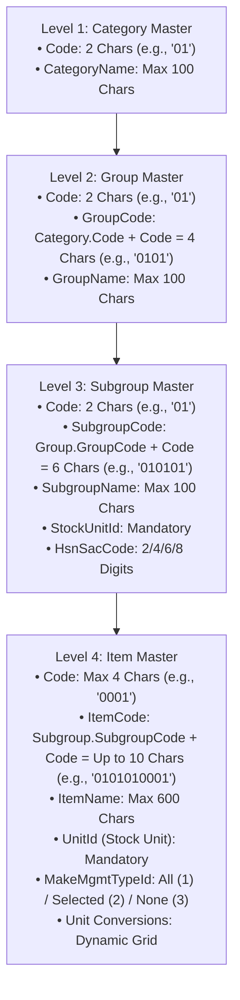
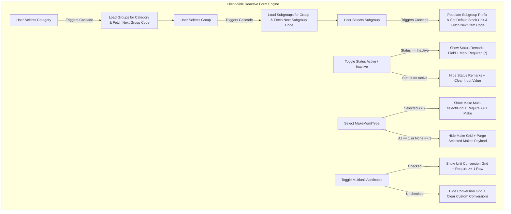

# Item Master, Subgroup, Group & Category Master: Full API & UI Validation Test Specification

> **Target Application Master Forms & Routes:**
> - **Category Master:** `/company/master/category` (Search/Grid) & `/company/master/category/create` (Modal/Form)
> - **Group Master:** `/company/master/group` (Search/Grid) & `/company/master/group/create` (Modal/Form)
> - **Subgroup Master:** `/company/master/subgroup` (Search/Grid) & `/company/master/subgroup/create` (Modal/Form)
> - **Item Master:** `/company/master/item` (Search/Grid) & `/company/master/item/create` (Form/Modal)
> - **Item Master Edit/View:** `/company/master/item/:id`
> 
> **Corresponding Backend Controllers & Endpoints:**
> - **Category API:** `eProcurement.Api.Controllers.Master.CategoryController` (`/api/master/categories`)
> - **Group API:** `eProcurement.Api.Controllers.Master.GroupController` (`/api/master/groups`)
> - **Subgroup API:** `eProcurement.Api.Controllers.Master.SubgroupController` (`/api/master/subgroups`)
> - **Item API:** `eProcurement.Api.Controllers.Master.ItemController` (`/api/master/items`)
> 
> **Scope & Purpose:** Comprehensive, production-grade test specification covering **all possible test cases** for the complete Item hierarchy across both **Part 1 (Backend REST API Validation)** and **Part 2 (Frontend User Interface & Parity Verification)**. Derived directly from the .NET Core backend architecture, FluentValidation rules, CoreServices business logic, and database relational constraints.

---

## 1. Master Hierarchy & Code Composition Architecture

The eProcurement master hierarchy enforces a strict four-level tree structure. Child codes are strictly derived from and prefixed by their parent codes.



### 1.1 Structural Hierarchy & Code Computation Matrix

| Level | Master Entity | Parent Master | Suffix Code | Full Composite Code | Length Limit | Auto-Generation Range | Parent Change Allowed If Child Exists? |
| :---: | :--- | :--- | :---: | :---: | :---: | :---: | :---: |
| **1** | **Category** | *Root* | `Code` (2 chars) | `Code` (2 chars) | Exactly 2 | `01` – `99` | N/A (Root) |
| **2** | **Group** | `Category` (`CategoryId`) | `Code` (2 chars) | `GroupCode` = `{Category.Code}{Code}` | Exactly 4 | `01` – `99` (per Category) | **No** (Locked if Subgroups exist) |
| **3** | **Subgroup** | `Group` (`GroupId`) | `Code` (2 chars) | `SubgroupCode` = `{Group.GroupCode}{Code}` | Exactly 6 | `01` – `99` (per Group) | **No** (Locked if Items exist) |
| **4** | **Item** | `Subgroup` (`SubgroupId`) | `Code` (up to 4 chars) | `ItemCode` = `{Subgroup.SubgroupCode}{Code}` | Up to 10 | `0001` – `9999` (per Subgroup) | **No** (Locked if Transactions exist) |

### 1.2 Common Master Base Rules (`MasterBaseModel`)

All four masters inherit from `MasterBaseModel` and enforce uniform status lifecycle rules:

1. **`StatusId`**:
   - Must be greater than 0 (`StatusId > 0`). Typical values: `1` = Active, `2` = Inactive.
2. **`StatusRemarks`**:
   - When `StatusId == 1` (Active): `StatusRemarks` **must be empty/null**.
   - When `StatusId != 1` (Inactive): `StatusRemarks` is **mandatory** and cannot exceed 300 characters.
3. **Optimistic Concurrency**:
   - `PUT` requests require a non-null `LastModifiedDate` matching the current database timestamp. Discrepancies result in HTTP 409 / Concurrency Conflict.
4. **Tenant & Vendor Security**:
   - All masters require authentication (`[Authorize]`).
   - Read/List endpoints enforce `RightsEnum.List`. Save enforces `RightsEnum.Save`. Update enforces `RightsEnum.Update`. Delete enforces `RightsEnum.Delete`.
   - `[VendorRestriction]` is placed on `GetById` and `GetNextCode` endpoints to prevent external supplier tampering.

---

# Part 1: Backend API Test Specifications

---

## 2. Category Master API Test Cases (`/api/master/categories`)

### 2.1 Category Master Endpoints Under Test

| HTTP Method | Route | Description | Required Authorization |
| :--- | :--- | :--- | :--- |
| `POST` | `/api/master/categories` | Save / Create new Category | `[Rights(FormEnum.CategoryMaster, RightsEnum.Save)]` |
| `PUT` | `/api/master/categories/{id}` | Update existing Category | `[Rights(FormEnum.CategoryMaster, RightsEnum.Update)]` |
| `GET` | `/api/master/categories/get` | Dropdown / Lookup Active Categories | `[Authorize]` |
| `GET` | `/api/master/categories` | Paged Search & List Categories | `[Rights(FormEnum.CategoryMaster, RightsEnum.List)]` |
| `GET` | `/api/master/categories/{id}` | Get Category by ID | `[Authorize]`, `[VendorRestriction]` |
| `DELETE` | `/api/master/categories/{id}` | Delete Category | `[Rights(FormEnum.CategoryMaster, RightsEnum.Delete)]` |
| `GET` | `/api/master/categories/next-code` | Auto-generate next 2-digit Code | `[Authorize]`, `[VendorRestriction]` |

### 2.2 Category API Test Cases Matrix

| Test Case ID | Endpoint & Method | Test Scenario / Payload Input | Expected Status | Expected Response / Validation Error Message | Code Rule Reference |
| :--- | :--- | :--- | :---: | :--- | :--- |
| `API-CAT-001` | `POST /api/master/categories` | Valid payload: `{"code": "01", "categoryName": "Raw Materials", "statusId": 1, "statusRemarks": null}` | `200 OK` | `{"isSuccess": true, "responseType": 1, "data": {"id": 1, "code": "01", "name": "Raw Materials"}}` | [CategoryController.cs:23-28](file:///c:/Users/shekh/Downloads/Telegram%20Desktop/eProcurement-Develop%20(5)/eProcurement-Develop/Api/Controllers/Master/CategoryController.cs#L23-L28) |
| `API-CAT-002` | `POST /api/master/categories` | Missing `Code`: `{"code": "", "categoryName": "Hardware", "statusId": 1}` | `400 Bad Request` | `"Code is required"` | [CategoryModelValidator.cs:11](file:///c:/Users/shekh/Downloads/Telegram%20Desktop/eProcurement-Develop%20(5)/eProcurement-Develop/Api/ModelValidators/Master/CategoryModelValidator.cs#L11) |
| `API-CAT-003` | `POST /api/master/categories` | `Code` exceeds 2 chars: `{"code": "001", "categoryName": "Electrical", "statusId": 1}` | `400 Bad Request` | `"Code maximum length cannot exceed 2 characters."` | [CategoryModelValidator.cs:11](file:///c:/Users/shekh/Downloads/Telegram%20Desktop/eProcurement-Develop%20(5)/eProcurement-Develop/Api/ModelValidators/Master/CategoryModelValidator.cs#L11) |
| `API-CAT-004` | `POST /api/master/categories` | Duplicate `Code`: Submit code `"01"` when `"01"` already exists in DB | `400 Bad Request` | `"Duplicate Code not allowed."` | [CategoryCoreService.cs:24-25](file:///c:/Users/shekh/Downloads/Telegram%20Desktop/eProcurement-Develop%20(5)/eProcurement-Develop/Core/Services/Master/CategoryCoreService.cs#L24-L25) |
| `API-CAT-005` | `POST /api/master/categories` | Missing `CategoryName`: `{"code": "02", "categoryName": "", "statusId": 1}` | `400 Bad Request` | `"CategoryName is required"` | [CategoryModelValidator.cs:12](file:///c:/Users/shekh/Downloads/Telegram%20Desktop/eProcurement-Develop%20(5)/eProcurement-Develop/Api/ModelValidators/Master/CategoryModelValidator.cs#L12) |
| `API-CAT-006` | `POST /api/master/categories` | `CategoryName` exceeds 100 chars: String with 101 characters | `400 Bad Request` | `"CategoryName maximum length cannot exceed 100 characters."` | [CategoryModelValidator.cs:12](file:///c:/Users/shekh/Downloads/Telegram%20Desktop/eProcurement-Develop%20(5)/eProcurement-Develop/Api/ModelValidators/Master/CategoryModelValidator.cs#L12) |
| `API-CAT-007` | `POST /api/master/categories` | Duplicate `CategoryName`: Case-insensitive match (e.g. `"raw materials"` vs `"RAW MATERIALS"`) | `400 Bad Request` | `"Duplicate Category Name not allowed."` | [CategoryCoreService.cs:14-15](file:///c:/Users/shekh/Downloads/Telegram%20Desktop/eProcurement-Develop%20(5)/eProcurement-Develop/Core/Services/Master/CategoryCoreService.cs#L14-L15) |
| `API-CAT-008` | `POST /api/master/categories` | Active Status (`statusId: 1`) with non-empty `statusRemarks: "Test Remarks"` | `400 Bad Request` | `"Status remarks must be empty when status is Active."` | [MasterBaseValidator.cs:21-24](file:///c:/Users/shekh/Downloads/Telegram%20Desktop/eProcurement-Develop%20(5)/eProcurement-Develop/Api/ModelValidators/MasterBaseValidator.cs#L21-L24) |
| `API-CAT-009` | `POST /api/master/categories` | Inactive Status (`statusId: 2`) with empty `statusRemarks: ""` | `400 Bad Request` | `"Status remarks are required when status is Inactive."` / `"Status Remarks is required."` | [MasterBaseValidator.cs:26-29](file:///c:/Users/shekh/Downloads/Telegram%20Desktop/eProcurement-Develop%20(5)/eProcurement-Develop/Api/ModelValidators/MasterBaseValidator.cs#L26-L29) |
| `API-CAT-010` | `POST /api/master/categories` | Inactive Status (`statusId: 2`) with valid remarks: `statusRemarks: "Deprecated category"` | `200 OK` | Category saved successfully with Inactive status | [MasterBaseValidator.cs:26-29](file:///c:/Users/shekh/Downloads/Telegram%20Desktop/eProcurement-Develop%20(5)/eProcurement-Develop/Api/ModelValidators/MasterBaseValidator.cs#L26-L29) |
| `API-CAT-011` | `POST /api/master/categories` | Inactive Status with `statusRemarks` > 300 characters | `400 Bad Request` | `"Status remarks must not exceed 300 characters."` | [MasterBaseValidator.cs:16-19](file:///c:/Users/shekh/Downloads/Telegram%20Desktop/eProcurement-Develop%20(5)/eProcurement-Develop/Api/ModelValidators/MasterBaseValidator.cs#L16-L19) |
| `API-CAT-012` | `GET /api/master/categories/next-code` | Database has categories `01`, `02`, `03` | `200 OK` | `{"code": "04"}` | [CategoryRepository.cs:263-283](file:///c:/Users/shekh/Downloads/Telegram%20Desktop/eProcurement-Develop%20(5)/eProcurement-Develop/Infrastructure/Repositories/Master/CategoryRepository.cs#L263-L283) |
| `API-CAT-013` | `GET /api/master/categories/next-code` | Database has zero categories | `200 OK` | `{"code": "01"}` | [CategoryRepository.cs:274-275](file:///c:/Users/shekh/Downloads/Telegram%20Desktop/eProcurement-Develop%20(5)/eProcurement-Develop/Infrastructure/Repositories/Master/CategoryRepository.cs#L274-L275) |
| `API-CAT-014` | `GET /api/master/categories/next-code` | Database max numeric code reaches `99` | `400 Bad Request` | `"Code generation limit reached."` | [CategoryService.cs:200-205](file:///c:/Users/shekh/Downloads/Telegram%20Desktop/eProcurement-Develop%20(5)/eProcurement-Develop/Api/Services/Master/CategoryService.cs#L200-L205) |
| `API-CAT-015` | `PUT /api/master/categories/{id}` | Update ID <= 0: `PUT /api/master/categories/0` | `400 Bad Request` | `"Id is required."` | [CategoryController.cs:34-37](file:///c:/Users/shekh/Downloads/Telegram%20Desktop/eProcurement-Develop%20(5)/eProcurement-Develop/Api/Controllers/Master/CategoryController.cs#L34-L37) |
| `API-CAT-016` | `PUT /api/master/categories/{id}` | Missing `lastModifiedDate`: Payload omits concurrency token | `400 Bad Request` | `"LastModifiedDate is required."` | [CategoryModelValidator.cs:31](file:///c:/Users/shekh/Downloads/Telegram%20Desktop/eProcurement-Develop%20(5)/eProcurement-Develop/Api/ModelValidators/Master/CategoryModelValidator.cs#L31) |
| `API-CAT-017` | `PUT /api/master/categories/{id}` | Attempt to change `Code` from `"01"` to `"09"` when Category has $\ge 1$ child Group | `400 Bad Request` | `"Cannot update the Code if the Category is associated with a Group"` | [CategoryCoreService.cs:19-20](file:///c:/Users/shekh/Downloads/Telegram%20Desktop/eProcurement-Develop%20(5)/eProcurement-Develop/Core/Services/Master/CategoryCoreService.cs#L19-L20) |
| `API-CAT-018` | `PUT /api/master/categories/{id}` | Update `CategoryName` when Category has child Groups (Code left unchanged) | `200 OK` | Successfully updated category name | [CategoryCoreService.cs:19-23](file:///c:/Users/shekh/Downloads/Telegram%20Desktop/eProcurement-Develop%20(5)/eProcurement-Develop/Core/Services/Master/CategoryCoreService.cs#L19-L23) |
| `API-CAT-019` | `PUT /api/master/categories/{id}` | Update Category with stale `lastModifiedDate` (Concurrency violation) | `409 Conflict` | Concurrency exception / DB update conflict | Concurrency Token Model |
| `API-CAT-020` | `DELETE /api/master/categories/{id}` | Delete non-existent ID `99999` | `404 Not Found` | KeyNotFoundException | [CategoryRepository.cs:116-119](file:///c:/Users/shekh/Downloads/Telegram%20Desktop/eProcurement-Develop%20(5)/eProcurement-Develop/Infrastructure/Repositories/Master/CategoryRepository.cs#L116-L119) |
| `API-CAT-021` | `DELETE /api/master/categories/{id}` | Delete Category that has associated child Groups | `400 / 500 DB Error` | Foreign Key Constraint Violation (Cannot delete record with dependent children) | Relational Integrity |
| `API-CAT-022` | `DELETE /api/master/categories/{id}` | Delete standalone Category with no child groups | `200 OK` | `{"isSuccess": true, "responseType": 3, "data": true}` | [CategoryController.cs:72-73](file:///c:/Users/shekh/Downloads/Telegram%20Desktop/eProcurement-Develop%20(5)/eProcurement-Develop/Api/Controllers/Master/CategoryController.cs#L72-L73) |
| `API-CAT-023` | `GET /api/master/categories/get` | Query active categories for dropdown | `200 OK` | Returns list of categories filtered strictly by `statusId == 1` | [CategoryRepository.cs:153](file:///c:/Users/shekh/Downloads/Telegram%20Desktop/eProcurement-Develop%20(5)/eProcurement-Develop/Infrastructure/Repositories/Master/CategoryRepository.cs#L153) |

---

## 3. Group Master API Test Cases (`/api/master/groups`)

### 3.1 Group Master Endpoints Under Test

| HTTP Method | Route | Description | Required Authorization |
| :--- | :--- | :--- | :--- |
| `POST` | `/api/master/groups` | Save / Create new Group | `[Rights(FormEnum.GroupMaster, RightsEnum.Save)]` |
| `PUT` | `/api/master/groups/{id}` | Update existing Group | `[Rights(FormEnum.GroupMaster, RightsEnum.Update)]` |
| `GET` | `/api/master/groups/get` | Dropdown Lookup (Anonymous Allowed) | `[AllowAnonymous]` |
| `GET` | `/api/master/groups` | Paged Search & List Groups | `[Rights(FormEnum.GroupMaster, RightsEnum.List)]` |
| `GET` | `/api/master/groups/{id}` | Get Group by ID | `[Authorize]`, `[VendorRestriction]` |
| `DELETE` | `/api/master/groups/{id}` | Delete Group | `[Rights(FormEnum.GroupMaster, RightsEnum.Delete)]` |
| `GET` | `/api/master/groups/next-code/{categoryId}` | Auto-generate next 2-digit Code for Category | `[Rights(FormEnum.GroupMaster, RightsEnum.List)]` |

### 3.2 Group API Test Cases Matrix

| Test Case ID | Endpoint & Method | Test Scenario / Payload Input | Expected Status | Expected Response / Validation Error Message | Code Rule Reference |
| :--- | :--- | :--- | :---: | :--- | :--- |
| `API-GRP-001` | `POST /api/master/groups` | Valid payload: `{"categoryId": 1, "code": "01", "groupCode": "0101", "groupName": "Pipes & Fittings", "statusId": 1}` | `200 OK` | `{"isSuccess": true, "responseType": 1, "data": {"id": 1, "code": "0101", "name": "Pipes & Fittings"}}` | [GroupController.cs:23-28](file:///c:/Users/shekh/Downloads/Telegram%20Desktop/eProcurement-Develop%20(5)/eProcurement-Develop/Api/Controllers/Master/GroupController.cs#L23-L28) |
| `API-GRP-002` | `POST /api/master/groups` | Missing `CategoryId`: `{"categoryId": 0, "code": "01", "groupCode": "0101", "groupName": "Valves"}` | `400 Bad Request` | `"Category Id is required."` | [GroupModelValidator.cs:19-20](file:///c:/Users/shekh/Downloads/Telegram%20Desktop/eProcurement-Develop%20(5)/eProcurement-Develop/Api/ModelValidators/Master/GroupModelValidator.cs#L19-L20) |
| `API-GRP-003` | `POST /api/master/groups` | Inactive or non-existent `CategoryId`: `{"categoryId": 9999, ...}` | `400 Bad Request` | `"Category is inactive or does not exist."` | [GroupCoreService.cs:20-21](file:///c:/Users/shekh/Downloads/Telegram%20Desktop/eProcurement-Develop%20(5)/eProcurement-Develop/Core/Services/Master/GroupCoreService.cs#L20-L21) |
| `API-GRP-004` | `POST /api/master/groups` | Missing `Code`: `{"categoryId": 1, "code": "", "groupName": "Valves"}` | `400 Bad Request` | `"Code is required."` | [GroupModelValidator.cs:12](file:///c:/Users/shekh/Downloads/Telegram%20Desktop/eProcurement-Develop%20(5)/eProcurement-Develop/Api/ModelValidators/Master/GroupModelValidator.cs#L12) |
| `API-GRP-005` | `POST /api/master/groups` | `Code` length != 2 chars (e.g. `"1"` or `"001"`) | `400 Bad Request` | `"Code must be of 2 characters."` | [GroupModelValidator.cs:13](file:///c:/Users/shekh/Downloads/Telegram%20Desktop/eProcurement-Develop%20(5)/eProcurement-Develop/Api/ModelValidators/Master/GroupModelValidator.cs#L13) |
| `API-GRP-006` | `POST /api/master/groups` | Mismatched `groupCode`: Category Code is `"01"`, Group Code is `"02"`, but client sends `groupCode: "0199"` | `400 Bad Request` | `"Invalid Group Code."` | [GroupCoreService.cs:23-26](file:///c:/Users/shekh/Downloads/Telegram%20Desktop/eProcurement-Develop%20(5)/eProcurement-Develop/Core/Services/Master/GroupCoreService.cs#L23-L26) |
| `API-GRP-007` | `POST /api/master/groups` | Duplicate `groupCode`: Send `groupCode: "0101"` when `"0101"` already exists in DB | `400 Bad Request` | `"Duplicate Group Code is not allowed."` | [GroupCoreService.cs:27-28](file:///c:/Users/shekh/Downloads/Telegram%20Desktop/eProcurement-Develop%20(5)/eProcurement-Develop/Core/Services/Master/GroupCoreService.cs#L27-L28) |
| `API-GRP-008` | `POST /api/master/groups` | Missing `GroupName`: `{"categoryId": 1, "code": "02", "groupCode": "0102", "groupName": ""}` | `400 Bad Request` | `"Group Name is required."` | [GroupModelValidator.cs:16](file:///c:/Users/shekh/Downloads/Telegram%20Desktop/eProcurement-Develop%20(5)/eProcurement-Develop/Api/ModelValidators/Master/GroupModelValidator.cs#L16) |
| `API-GRP-009` | `POST /api/master/groups` | `GroupName` exceeds 100 characters | `400 Bad Request` | `"Group Name maximum length cannot exceed 100 characters."` | [GroupModelValidator.cs:17](file:///c:/Users/shekh/Downloads/Telegram%20Desktop/eProcurement-Develop%20(5)/eProcurement-Develop/Api/ModelValidators/Master/GroupModelValidator.cs#L17) |
| `API-GRP-010` | `POST /api/master/groups` | Duplicate `GroupName`: Group Name exists globally across all groups | `400 Bad Request` | `"Duplicate Group Name is not allowed."` | [GroupCoreService.cs:31-32](file:///c:/Users/shekh/Downloads/Telegram%20Desktop/eProcurement-Develop%20(5)/eProcurement-Develop/Core/Services/Master/GroupCoreService.cs#L31-L32) |
| `API-GRP-011` | `GET /api/master/groups/next-code/{categoryId}` | Valid active Category ID with existing groups `01`, `02` | `200 OK` | `{"code": "03"}` | [GroupRepository.cs:250-255](file:///c:/Users/shekh/Downloads/Telegram%20Desktop/eProcurement-Develop%20(5)/eProcurement-Develop/Infrastructure/Repositories/Master/GroupRepository.cs#L250-L255) |
| `API-GRP-012` | `GET /api/master/groups/next-code/{categoryId}` | Inactive or non-existent `categoryId` | `404 Not Found` | `"Selected Category is inactive or does not exist."` | [GroupRepository.cs:253-254](file:///c:/Users/shekh/Downloads/Telegram%20Desktop/eProcurement-Develop%20(5)/eProcurement-Develop/Infrastructure/Repositories/Master/GroupRepository.cs#L253-L254) |
| `API-GRP-013` | `GET /api/master/groups/next-code/{categoryId}` | Max numeric group code under category reaches `99` | `400 Bad Request` | `"Code generation limit reached."` | [GroupService.cs:234-238](file:///c:/Users/shekh/Downloads/Telegram%20Desktop/eProcurement-Develop%20(5)/eProcurement-Develop/Api/Services/Master/GroupService.cs#L234-L238) |
| `API-GRP-014` | `PUT /api/master/groups/{id}` | Attempt to modify `Code` when Group is associated with $\ge 1$ Subgroup | `400 Bad Request` | `"Code is not allowed to be updated. As group is associated with subgroup."` | [GroupCoreService.cs:44-47](file:///c:/Users/shekh/Downloads/Telegram%20Desktop/eProcurement-Develop%20(5)/eProcurement-Develop/Core/Services/Master/GroupCoreService.cs#L44-L47) |
| `API-GRP-015` | `PUT /api/master/groups/{id}` | Attempt to change `CategoryId` when Group is associated with $\ge 1$ Subgroup | `400 Bad Request` | `"Category is not allowed to be updated. As group is associated with subgroup."` | [GroupCoreService.cs:49-52](file:///c:/Users/shekh/Downloads/Telegram%20Desktop/eProcurement-Develop%20(5)/eProcurement-Develop/Core/Services/Master/GroupCoreService.cs#L49-L52) |
| `API-GRP-016` | `PUT /api/master/groups/{id}` | Update Group when `id` does not exist | `400 Bad Request` | `"Group does not exist."` | [GroupCoreService.cs:40-41](file:///c:/Users/shekh/Downloads/Telegram%20Desktop/eProcurement-Develop%20(5)/eProcurement-Develop/Core/Services/Master/GroupCoreService.cs#L40-L41) |
| `API-GRP-017` | `PUT /api/master/groups/{id}` | Update Group without `lastModifiedDate` | `400 Bad Request` | `"LastModifiedDate is required."` | [GroupModelValidator.cs:40](file:///c:/Users/shekh/Downloads/Telegram%20Desktop/eProcurement-Develop%20(5)/eProcurement-Develop/Api/ModelValidators/Master/GroupModelValidator.cs#L40) |
| `API-GRP-018` | `DELETE /api/master/groups/{id}` | Delete Group associated with $\ge 1$ Subgroup | `400 / 500 DB Error` | Foreign Key Constraint Violation | Relational Integrity |
| `API-GRP-019` | `DELETE /api/master/groups/{id}` | Delete Group with no child subgroups | `200 OK` | `{"isSuccess": true, "responseType": 3, "data": true}` | [GroupController.cs:68-72](file:///c:/Users/shekh/Downloads/Telegram%20Desktop/eProcurement-Develop%20(5)/eProcurement-Develop/Api/Controllers/Master/GroupController.cs#L68-L72) |

---

## 4. Subgroup Master API Test Cases (`/api/master/subgroups`)

### 4.1 Subgroup Master Endpoints Under Test

| HTTP Method | Route | Description | Required Authorization |
| :--- | :--- | :--- | :--- |
| `POST` | `/api/master/subgroups` | Save / Create new Subgroup | `[Rights(FormEnum.SubgroupMaster, RightsEnum.Save)]` |
| `PUT` | `/api/master/subgroups/{id}` | Update existing Subgroup | `[Rights(FormEnum.SubgroupMaster, RightsEnum.Update)]` |
| `GET` | `/api/master/subgroups/get` | Dropdown Lookup (Anonymous Allowed) | `[AllowAnonymous]` |
| `GET` | `/api/master/subgroups` | Paged Search & List Subgroups | `[Rights(FormEnum.SubgroupMaster, RightsEnum.List)]` |
| `GET` | `/api/master/subgroups/{id}` | Get Subgroup by ID | `[Authorize]`, `[VendorRestriction]` |
| `DELETE` | `/api/master/subgroups/{id}` | Delete Subgroup | `[Rights(FormEnum.SubgroupMaster, RightsEnum.Delete)]` |
| `GET` | `/api/master/subgroups/next-code/{groupId}` | Auto-generate next 2-digit Code for Group | `[Authorize]`, `[VendorRestriction]` |

### 4.2 Subgroup API Test Cases Matrix

| Test Case ID | Endpoint & Method | Test Scenario / Payload Input | Expected Status | Expected Response / Validation Error Message | Code Rule Reference |
| :--- | :--- | :--- | :---: | :--- | :--- |
| `API-SBG-001` | `POST /api/master/subgroups` | Valid payload: `{"groupId": 1, "code": "01", "subgroupCode": "010101", "subgroupName": "Seamless Pipes", "stockUnitId": 2, "gstCategoryId": 1, "hsnSacCode": "7304", "statusId": 1}` | `200 OK` | `{"isSuccess": true, "responseType": 1, "data": {"id": 1, "code": "010101", "name": "Seamless Pipes"}}` | [SubgroupController.cs:25-30](file:///c:/Users/shekh/Downloads/Telegram%20Desktop/eProcurement-Develop%20(5)/eProcurement-Develop/Api/Controllers/Master/SubgroupController.cs#L25-L30) |
| `API-SBG-002` | `POST /api/master/subgroups` | Missing `GroupId`: `{"groupId": 0, "code": "01", ...}` | `400 Bad Request` | `"Group Id is required."` / `"Group Id must be greater than 0."` | [SubgroupModelValidator.cs:18-19](file:///c:/Users/shekh/Downloads/Telegram%20Desktop/eProcurement-Develop%20(5)/eProcurement-Develop/Api/ModelValidators/Master/SubgroupModelValidator.cs#L18-L19) |
| `API-SBG-003` | `POST /api/master/subgroups` | Inactive or non-existent `GroupId`: `{"groupId": 9999, ...}` | `400 Bad Request` | `"Group is inactive or does not exist."` | [SubgroupCoreService.cs:19-20](file:///c:/Users/shekh/Downloads/Telegram%20Desktop/eProcurement-Develop%20(5)/eProcurement-Develop/Core/Services/Master/SubgroupCoreService.cs#L19-L20) |
| `API-SBG-004` | `POST /api/master/subgroups` | Missing `Code`: `{"code": "", ...}` | `400 Bad Request` | `"Code is required."` | [SubgroupModelValidator.cs:12](file:///c:/Users/shekh/Downloads/Telegram%20Desktop/eProcurement-Develop%20(5)/eProcurement-Develop/Api/ModelValidators/Master/SubgroupModelValidator.cs#L12) |
| `API-SBG-005` | `POST /api/master/subgroups` | `Code` length != 2 chars (e.g. `"1"` or `"100"`) | `400 Bad Request` | `"Code must be of 2 characters."` | [SubgroupModelValidator.cs:13](file:///c:/Users/shekh/Downloads/Telegram%20Desktop/eProcurement-Develop%20(5)/eProcurement-Develop/Api/ModelValidators/Master/SubgroupModelValidator.cs#L13) |
| `API-SBG-006` | `POST /api/master/subgroups` | Mismatched `subgroupCode`: Group code is `"0101"`, code is `"01"`, but payload has `subgroupCode: "010199"` | `400 Bad Request` | `"Invalid Subgroup Code."` | [SubgroupCoreService.cs:22-25](file:///c:/Users/shekh/Downloads/Telegram%20Desktop/eProcurement-Develop%20(5)/eProcurement-Develop/Core/Services/Master/SubgroupCoreService.cs#L22-L25) |
| `API-SBG-007` | `POST /api/master/subgroups` | Duplicate `subgroupCode`: Submit existing subgroup code `"010101"` | `400 Bad Request` | `"Duplicate Subgroup Code is not allowed."` | [SubgroupCoreService.cs:26-27](file:///c:/Users/shekh/Downloads/Telegram%20Desktop/eProcurement-Develop%20(5)/eProcurement-Develop/Core/Services/Master/SubgroupCoreService.cs#L26-L27) |
| `API-SBG-008` | `POST /api/master/subgroups` | Missing `StockUnitId`: `{"stockUnitId": 0, ...}` | `400 Bad Request` | `"Stock Unit Id is required."` | [SubgroupModelValidator.cs:20](file:///c:/Users/shekh/Downloads/Telegram%20Desktop/eProcurement-Develop%20(5)/eProcurement-Develop/Api/ModelValidators/Master/SubgroupModelValidator.cs#L20) |
| `API-SBG-009` | `POST /api/master/subgroups` | Inactive or invalid `StockUnitId`: `{"stockUnitId": 9999}` | `400 Bad Request` | `"Stock Unit is inactive or does not exist."` | [SubgroupCoreService.cs:35-36](file:///c:/Users/shekh/Downloads/Telegram%20Desktop/eProcurement-Develop%20(5)/eProcurement-Develop/Core/Services/Master/SubgroupCoreService.cs#L35-L36) |
| `API-SBG-010` | `POST /api/master/subgroups` | Inactive or invalid `GstCategoryId`: `{"gstCategoryId": 999}` | `400 Bad Request` | `"GST Category is inactive or does not exist."` | [SubgroupCoreService.cs:32-33](file:///c:/Users/shekh/Downloads/Telegram%20Desktop/eProcurement-Develop%20(5)/eProcurement-Develop/Core/Services/Master/SubgroupCoreService.cs#L32-L33) |
| `API-SBG-011` | `POST /api/master/subgroups` | Invalid `HsnSacCode` format: Odd length or non-digits (e.g. `"730"`, `"7304123"`, `"73A4"`) | `400 Bad Request` | `"Hsn Sac Code must be numeric and 2, 4, 6, or 8 characters in length."` | [SubgroupModelValidator.cs:21-25](file:///c:/Users/shekh/Downloads/Telegram%20Desktop/eProcurement-Develop%20(5)/eProcurement-Develop/Api/ModelValidators/Master/SubgroupModelValidator.cs#L21-L25) |
| `API-SBG-012` | `POST /api/master/subgroups` | Valid `HsnSacCode` values: `"12"`, `"7304"`, `"848180"`, `"99831312"` | `200 OK` | Accepted by regex `^(?:[0-9]{2}\|[0-9]{4}\|[0-9]{6}\|[0-9]{8})$` | [SubgroupModelValidator.cs:21-25](file:///c:/Users/shekh/Downloads/Telegram%20Desktop/eProcurement-Develop%20(5)/eProcurement-Develop/Api/ModelValidators/Master/SubgroupModelValidator.cs#L21-L25) |
| `API-SBG-013` | `POST /api/master/subgroups` | Duplicate `SubgroupName`: Globally unique check fails | `400 Bad Request` | `"Duplicate Subgroup Name is not allowed."` | [SubgroupCoreService.cs:29-30](file:///c:/Users/shekh/Downloads/Telegram%20Desktop/eProcurement-Develop%20(5)/eProcurement-Develop/Core/Services/Master/SubgroupCoreService.cs#L29-L30) |
| `API-SBG-014` | `GET /api/master/subgroups/next-code/{groupId}` | Valid Group ID with existing subgroups `01`, `02` | `200 OK` | `{"code": "03"}` | [SubgroupRepository.cs:275-289](file:///c:/Users/shekh/Downloads/Telegram%20Desktop/eProcurement-Develop%20(5)/eProcurement-Develop/Infrastructure/Repositories/Master/SubgroupRepository.cs#L275-L289) |
| `API-SBG-015` | `GET /api/master/subgroups/next-code/{groupId}` | Inactive or non-existent `groupId` | `404 Not Found` | `"Selected Group is inactive or does not exist."` | [SubgroupRepository.cs:278-279](file:///c:/Users/shekh/Downloads/Telegram%20Desktop/eProcurement-Develop%20(5)/eProcurement-Develop/Infrastructure/Repositories/Master/SubgroupRepository.cs#L278-L279) |
| `API-SBG-016` | `PUT /api/master/subgroups/{id}` | Attempt to change `Code` when Subgroup is associated with $\ge 1$ Item | `400 Bad Request` | `"Code is not allowed to be updated. As subgroup is associated with an Item."` | [SubgroupCoreService.cs:43-46](file:///c:/Users/shekh/Downloads/Telegram%20Desktop/eProcurement-Develop%20(5)/eProcurement-Develop/Core/Services/Master/SubgroupCoreService.cs#L43-L46) |
| `API-SBG-017` | `PUT /api/master/subgroups/{id}` | Attempt to change `GroupId` when Subgroup is associated with $\ge 1$ Item | `400 Bad Request` | `"Group is not allowed to be updated. As subgroup is associated with an Item."` | [SubgroupCoreService.cs:47-50](file:///c:/Users/shekh/Downloads/Telegram%20Desktop/eProcurement-Develop%20(5)/eProcurement-Develop/Core/Services/Master/SubgroupCoreService.cs#L47-L50) |
| `API-SBG-018` | `PUT /api/master/subgroups/{id}` | Attempt to change `StockUnitId` when Subgroup is associated with $\ge 1$ Item | `400 Bad Request` | `"Stock Unit is not allowed to be updated. As subgroup is associated with an Item."` | [SubgroupCoreService.cs:51-54](file:///c:/Users/shekh/Downloads/Telegram%20Desktop/eProcurement-Develop%20(5)/eProcurement-Develop/Core/Services/Master/SubgroupCoreService.cs#L51-L54) |
| `API-SBG-019` | `PUT /api/master/subgroups/{id}` | Attempt to change `SubgroupCode` when Subgroup is associated with $\ge 1$ Item | `400 Bad Request` | `"Subgroup Code is not allowed to be updated. As subgroup is associated with an Item."` | [SubgroupCoreService.cs:55-58](file:///c:/Users/shekh/Downloads/Telegram%20Desktop/eProcurement-Develop%20(5)/eProcurement-Develop/Core/Services/Master/SubgroupCoreService.cs#L55-L58) |
| `API-SBG-020` | `DELETE /api/master/subgroups/{id}` | Delete Subgroup associated with $\ge 1$ Item | `400 / 500 DB Error` | Foreign Key Constraint Violation | Relational Integrity |
| `API-SBG-021` | `DELETE /api/master/subgroups/{id}` | Delete standalone Subgroup with no child items | `200 OK` | `{"isSuccess": true, "responseType": 3, "data": true}` | [SubgroupController.cs:70-75](file:///c:/Users/shekh/Downloads/Telegram%20Desktop/eProcurement-Develop%20(5)/eProcurement-Develop/Api/Controllers/Master/SubgroupController.cs#L70-L75) |

---

## 5. Item Master API Test Cases (`/api/master/items`)

### 5.1 Item Master Endpoints Under Test

| HTTP Method | Route | Description | Required Authorization |
| :--- | :--- | :--- | :--- |
| `POST` | `/api/master/items` | Save / Create new Item Master | `[Rights(FormEnum.Item, RightsEnum.Save)]` |
| `PUT` | `/api/master/items/{id}` | Update existing Item Master | `[Rights(FormEnum.Item, RightsEnum.Update)]` |
| `GET` | `/api/master/items/get` | Dropdown Lookup Active Items | `[Authorize]` |
| `GET` | `/api/master/items` | Paged Search & List Items | `[Rights(FormEnum.Item, RightsEnum.List)]` |
| `GET` | `/api/master/items/{id}` | Get Item by ID (includes makes & conversions) | `[Authorize]`, `[VendorRestriction]` |
| `DELETE` | `/api/master/items/{id}` | Delete Item Master | `[Rights(FormEnum.Item, RightsEnum.Delete)]` |
| `GET` | `/api/master/items/next-code/{subgroupId}` | Auto-generate next 4-digit Code for Subgroup | `[Authorize]`, `[VendorRestriction]` |
| `GET` | `/api/master/items/unit` | Fetch available units (filter by unit types) | `[Authorize]` |
| `GET` | `/api/master/items/make` | Fetch available makes | `[Authorize]` |

### 5.2 Item Master API Test Cases Matrix

| Test Case ID | Endpoint & Method | Test Scenario / Payload Input | Expected Status | Expected Response / Validation Error Message | Code Rule Reference |
| :--- | :--- | :--- | :---: | :--- | :--- |
| `API-ITM-001` | `POST /api/master/items` | Valid standard payload: `{"subgroupId": 1, "code": "0001", "itemCode": "0101010001", "itemName": "SS 304 Seamless Pipe 25mm", "unitId": 2, "makeMgmtTypeId": 1, "isMultiunitApplicable": false, "statusId": 1}` | `200 OK` | `{"isSuccess": true, "responseType": 1, "data": {"id": 1, "code": "0101010001", "name": "SS 304 Seamless Pipe 25mm"}}` | [ItemController.cs:23-28](file:///c:/Users/shekh/Downloads/Telegram%20Desktop/eProcurement-Develop%20(5)/eProcurement-Develop/Api/Controllers/Master/ItemController.cs#L23-L28) |
| `API-ITM-002` | `POST /api/master/items` | Missing `SubgroupId`: `{"subgroupId": 0, ...}` | `400 Bad Request` | `"SubgroupId is required."` | [ItemModelValidator.cs:95-98](file:///c:/Users/shekh/Downloads/Telegram%20Desktop/eProcurement-Develop%20(5)/eProcurement-Develop/Api/ModelValidators/Master/ItemModelValidator.cs#L95-L98) |
| `API-ITM-003` | `POST /api/master/items` | Inactive or non-existent `SubgroupId`: `{"subgroupId": 9999, ...}` | `400 Bad Request` | `"Subgroup is inactive or does not exist."` | [ItemCoreService.cs:23-27](file:///c:/Users/shekh/Downloads/Telegram%20Desktop/eProcurement-Develop%20(5)/eProcurement-Develop/Core/Services/Master/ItemCoreService.cs#L23-L27) |
| `API-ITM-004` | `POST /api/master/items` | Missing `Code`: `{"code": "", ...}` | `400 Bad Request` | `"Code is required."` | [ItemModelValidator.cs:67-70](file:///c:/Users/shekh/Downloads/Telegram%20Desktop/eProcurement-Develop%20(5)/eProcurement-Develop/Api/ModelValidators/Master/ItemModelValidator.cs#L67-L70) |
| `API-ITM-005` | `POST /api/master/items` | `Code` exceeds 4 characters (e.g. `"12345"`) | `400 Bad Request` | `"Code maximum length cannot exceed 4 characters."` | [ItemModelValidator.cs:71-73](file:///c:/Users/shekh/Downloads/Telegram%20Desktop/eProcurement-Develop%20(5)/eProcurement-Develop/Api/ModelValidators/Master/ItemModelValidator.cs#L71-L73) |
| `API-ITM-006` | `POST /api/master/items` | Missing `ItemCode`: `{"itemCode": "", ...}` | `400 Bad Request` | `"ItemCode is required."` | [ItemModelValidator.cs:75-78](file:///c:/Users/shekh/Downloads/Telegram%20Desktop/eProcurement-Develop%20(5)/eProcurement-Develop/Api/ModelValidators/Master/ItemModelValidator.cs#L75-L78) |
| `API-ITM-007` | `POST /api/master/items` | `ItemCode` exceeds 10 characters | `400 Bad Request` | `"ItemCode maximum length cannot exceed 10 characters."` | [ItemModelValidator.cs:79-81](file:///c:/Users/shekh/Downloads/Telegram%20Desktop/eProcurement-Develop%20(5)/eProcurement-Develop/Api/ModelValidators/Master/ItemModelValidator.cs#L79-L81) |
| `API-ITM-008` | `POST /api/master/items` | `ItemCode` does not end with `Code`: `code: "0001"`, `itemCode: "0101019999"` | `400 Bad Request` | `"Item Code contains an invalid value."` | [ItemModelValidator.cs:82-86](file:///c:/Users/shekh/Downloads/Telegram%20Desktop/eProcurement-Develop%20(5)/eProcurement-Develop/Api/ModelValidators/Master/ItemModelValidator.cs#L82-L86) |
| `API-ITM-009` | `POST /api/master/items` | `ItemCode` prefix does not match Subgroup Code: Subgroup code is `"010101"`, item code sent is `"9999990001"` | `400 Bad Request` | `"Item Code contains an invalid value."` | [ItemCoreService.cs:48-53](file:///c:/Users/shekh/Downloads/Telegram%20Desktop/eProcurement-Develop%20(5)/eProcurement-Develop/Core/Services/Master/ItemCoreService.cs#L48-L53) |
| `API-ITM-010` | `POST /api/master/items` | Duplicate `ItemCode`: Submit item code that already exists | `400 Bad Request` | `"Duplicate Item Code is not allowed."` | [ItemCoreService.cs:55-58](file:///c:/Users/shekh/Downloads/Telegram%20Desktop/eProcurement-Develop%20(5)/eProcurement-Develop/Core/Services/Master/ItemCoreService.cs#L55-L58) |
| `API-ITM-011` | `POST /api/master/items` | Missing `ItemName`: `{"itemName": "", ...}` | `400 Bad Request` | `"ItemName is required."` | [ItemModelValidator.cs:59-62](file:///c:/Users/shekh/Downloads/Telegram%20Desktop/eProcurement-Develop%20(5)/eProcurement-Develop/Api/ModelValidators/Master/ItemModelValidator.cs#L59-L62) |
| `API-ITM-012` | `POST /api/master/items` | `ItemName` exceeds 600 characters | `400 Bad Request` | `"ItemName maximum length cannot exceed 600 characters."` | [ItemModelValidator.cs:63-65](file:///c:/Users/shekh/Downloads/Telegram%20Desktop/eProcurement-Develop%20(5)/eProcurement-Develop/Api/ModelValidators/Master/ItemModelValidator.cs#L63-L65) |
| `API-ITM-013` | `POST /api/master/items` | Duplicate `ItemName` within same Subgroup: Item name exists under `subgroupId: 1` | `400 Bad Request` | `"Duplicate Item Name is not allowed."` | [ItemCoreService.cs:60-63](file:///c:/Users/shekh/Downloads/Telegram%20Desktop/eProcurement-Develop%20(5)/eProcurement-Develop/Core/Services/Master/ItemCoreService.cs#L60-L63) |
| `API-ITM-014` | `POST /api/master/items` | Same `ItemName` under *different* Subgroup: `subgroupId: 2` (Allowed by business logic) | `200 OK` | Successfully created item under different subgroup | [ItemCoreService.cs:60](file:///c:/Users/shekh/Downloads/Telegram%20Desktop/eProcurement-Develop%20(5)/eProcurement-Develop/Core/Services/Master/ItemCoreService.cs#L60) |
| `API-ITM-015` | `POST /api/master/items` | Missing `UnitId` (Stock Unit): `{"unitId": 0, ...}` | `400 Bad Request` | `"UnitId is required."` | [ItemModelValidator.cs:88-93](file:///c:/Users/shekh/Downloads/Telegram%20Desktop/eProcurement-Develop%20(5)/eProcurement-Develop/Api/ModelValidators/Master/ItemModelValidator.cs#L88-L93) |
| `API-ITM-016` | `POST /api/master/items` | Inactive or non-existent `UnitId`: `{"unitId": 9999}` | `400 Bad Request` | `"Stock Unit is inactive or does not exist."` | [ItemCoreService.cs:29-33](file:///c:/Users/shekh/Downloads/Telegram%20Desktop/eProcurement-Develop%20(5)/eProcurement-Develop/Core/Services/Master/ItemCoreService.cs#L29-L33) |
| `API-ITM-017` | `POST /api/master/items` | Inactive or invalid `GstCategoryId`: `{"gstCategoryId": 999}` | `400 Bad Request` | `"GST Category is inactive or does not exist."` | [ItemCoreService.cs:35-39](file:///c:/Users/shekh/Downloads/Telegram%20Desktop/eProcurement-Develop%20(5)/eProcurement-Develop/Core/Services/Master/ItemCoreService.cs#L35-L39) |
| `API-ITM-018` | `POST /api/master/items` | Invalid `HsnSacCode` format: Odd length (e.g. `"730"`) or non-numeric | `400 Bad Request` | `"HsnSacCode must be numeric and 2, 4, 6, or 8 characters in length."` | [ItemModelValidator.cs:100-104](file:///c:/Users/shekh/Downloads/Telegram%20Desktop/eProcurement-Develop%20(5)/eProcurement-Develop/Api/ModelValidators/Master/ItemModelValidator.cs#L100-L104) |
| `API-ITM-019` | `POST /api/master/items` | Missing `MakeMgmtTypeId`: `{"makeMgmtTypeId": 0, ...}` | `400 Bad Request` | `"MakeMgmtTypeId is required."` | [ItemModelValidator.cs:112-115](file:///c:/Users/shekh/Downloads/Telegram%20Desktop/eProcurement-Develop%20(5)/eProcurement-Develop/Api/ModelValidators/Master/ItemModelValidator.cs#L112-L115) |
| `API-ITM-020` | `POST /api/master/items` | `MakeMgmtTypeId = Selected (2)` with empty `itemSelectedMakeDetail: []` | `400 Bad Request` | `"At least one Make is required when MakeMgmtTypeId is Selected."` / `"At least one Make is required when Make Management Type is Selected."` | [ItemModelValidator.cs:130-133](file:///c:/Users/shekh/Downloads/Telegram%20Desktop/eProcurement-Develop%20(5)/eProcurement-Develop/Api/ModelValidators/Master/ItemModelValidator.cs#L130-L133), [ItemCoreService.cs:65-68](file:///c:/Users/shekh/Downloads/Telegram%20Desktop/eProcurement-Develop%20(5)/eProcurement-Develop/Core/Services/Master/ItemCoreService.cs#L65-L68) |
| `API-ITM-021` | `POST /api/master/items` | `MakeMgmtTypeId = Selected (2)` with invalid `MakeId <= 0`: `[{"makeId": 0}]` | `400 Bad Request` | `"MakeId is required."` | [ItemModelValidator.cs:48-52](file:///c:/Users/shekh/Downloads/Telegram%20Desktop/eProcurement-Develop%20(5)/eProcurement-Develop/Api/ModelValidators/Master/ItemModelValidator.cs#L48-L52) |
| `API-ITM-022` | `POST /api/master/items` | `MakeMgmtTypeId = Selected (2)` with duplicate `MakeId`: `[{"makeId": 5}, {"makeId": 5}]` | `400 Bad Request` | `"Duplicate Make mapping is not allowed."` | [ItemModelValidator.cs:140-144](file:///c:/Users/shekh/Downloads/Telegram%20Desktop/eProcurement-Develop%20(5)/eProcurement-Develop/Api/ModelValidators/Master/ItemModelValidator.cs#L140-L144) |
| `API-ITM-023` | `POST /api/master/items` | `MakeMgmtTypeId = All (1)` with non-empty makes: `[{"makeId": 5}]` | `400 Bad Request` | `"ItemSelectedMakeDetail must be empty unless MakeMgmtTypeId is Selected."` | [ItemModelValidator.cs:135-138](file:///c:/Users/shekh/Downloads/Telegram%20Desktop/eProcurement-Develop%20(5)/eProcurement-Develop/Api/ModelValidators/Master/ItemModelValidator.cs#L135-L138) |
| `API-ITM-024` | `POST /api/master/items` | `MakeMgmtTypeId = None (3)` with non-empty makes: `[{"makeId": 5}]` | `400 Bad Request` | `"ItemSelectedMakeDetail must be empty unless MakeMgmtTypeId is Selected."` | [ItemModelValidator.cs:135-138](file:///c:/Users/shekh/Downloads/Telegram%20Desktop/eProcurement-Develop%20(5)/eProcurement-Develop/Api/ModelValidators/Master/ItemModelValidator.cs#L135-L138) |
| `API-ITM-025` | `POST /api/master/items` | `isMultiunitApplicable = true` with empty `unitConversionDetail: []` | `400 Bad Request` | `"At least one Unit Conversion Detail is required when IsMultiunitApplicable is true."` | [ItemCoreService.cs:79-86](file:///c:/Users/shekh/Downloads/Telegram%20Desktop/eProcurement-Develop%20(5)/eProcurement-Develop/Core/Services/Master/ItemCoreService.cs#L79-L86) |
| `API-ITM-026` | `POST /api/master/items` | Unit Conversion with `FromUnitId != unitId` (Base unit mismatch) | `400 Bad Request` | `"Base Unit must be the Stock Unit."` | [ItemCoreService.cs:71-77](file:///c:/Users/shekh/Downloads/Telegram%20Desktop/eProcurement-Develop%20(5)/eProcurement-Develop/Core/Services/Master/ItemCoreService.cs#L71-L77) |
| `API-ITM-027` | `POST /api/master/items` | Unit Conversion with missing `UnitTypeId`: `{"unitTypeId": 0, ...}` | `400 Bad Request` | `"Unit Type is required."` | [ItemModelValidator.cs:14-18](file:///c:/Users/shekh/Downloads/Telegram%20Desktop/eProcurement-Develop%20(5)/eProcurement-Develop/Api/ModelValidators/Master/ItemModelValidator.cs#L14-L18) |
| `API-ITM-028` | `POST /api/master/items` | Unit Conversion with duplicate `UnitTypeId` (e.g. two rows with `unitTypeId: 2` Purchase) | `400 Bad Request` | `"Duplicate Unit Type is not allowed."` | [ItemModelValidator.cs:117-121](file:///c:/Users/shekh/Downloads/Telegram%20Desktop/eProcurement-Develop%20(5)/eProcurement-Develop/Api/ModelValidators/Master/ItemModelValidator.cs#L117-L121) |
| `API-ITM-029` | `POST /api/master/items` | Unit Conversion with missing `UnitConversionTypeId`: `{"unitConversionTypeId": 0}` | `400 Bad Request` | `"Conversion Type is required."` | [ItemModelValidator.cs:19-23](file:///c:/Users/shekh/Downloads/Telegram%20Desktop/eProcurement-Develop%20(5)/eProcurement-Develop/Api/ModelValidators/Master/ItemModelValidator.cs#L19-L23) |
| `API-ITM-030` | `POST /api/master/items` | Unit Conversion with `FromUnitValue <= 0`: `{"fromUnitValue": 0}` | `400 Bad Request` | `"Base Unit Value must be greater than 0."` | [ItemModelValidator.cs:24-28](file:///c:/Users/shekh/Downloads/Telegram%20Desktop/eProcurement-Develop%20(5)/eProcurement-Develop/Api/ModelValidators/Master/ItemModelValidator.cs#L24-L28) |
| `API-ITM-031` | `POST /api/master/items` | Unit Conversion with `ToUnitId <= 0`: `{"toUnitId": 0}` | `400 Bad Request` | `"Conversion Unit is required when Conversion Type is selected."` | [ItemModelValidator.cs:30-34](file:///c:/Users/shekh/Downloads/Telegram%20Desktop/eProcurement-Develop%20(5)/eProcurement-Develop/Api/ModelValidators/Master/ItemModelValidator.cs#L30-L34) |
| `API-ITM-032` | `POST /api/master/items` | Unit Conversion with `ToUnitValue <= 0`: `{"toUnitValue": 0}` | `400 Bad Request` | `"Conversion Unit Value must be greater than 0."` | [ItemModelValidator.cs:36-40](file:///c:/Users/shekh/Downloads/Telegram%20Desktop/eProcurement-Develop%20(5)/eProcurement-Develop/Api/ModelValidators/Master/ItemModelValidator.cs#L36-L40) |
| `API-ITM-033` | `POST /api/master/items` | Auto-injection of Stock Unit conversion: Server automatically appends `(Stock, Fixed, 1 = 1)` | `200 OK` | Saved item contains base 1:1 Stock Unit conversion entry in database | [ItemService.cs:51-61](file:///c:/Users/shekh/Downloads/Telegram%20Desktop/eProcurement-Develop%20(5)/eProcurement-Develop/Api/Services/Master/ItemService.cs#L51-L61) |
| `API-ITM-034` | `POST /api/master/items` | `Remarks` exceeds 300 characters | `400 Bad Request` | `"Remarks maximum length cannot exceed 300 characters."` | [ItemModelValidator.cs:106-110](file:///c:/Users/shekh/Downloads/Telegram%20Desktop/eProcurement-Develop%20(5)/eProcurement-Develop/Api/ModelValidators/Master/ItemModelValidator.cs#L106-L110) |
| `API-ITM-035` | `GET /api/master/items/next-code/{subgroupId}` | Subgroup has items `0001`, `0002` | `200 OK` | `{"code": "0003"}` | [ItemRepository.cs:615-640](file:///c:/Users/shekh/Downloads/Telegram%20Desktop/eProcurement-Develop%20(5)/eProcurement-Develop/Infrastructure/Repositories/Master/ItemRepository.cs#L615-L640) |
| `API-ITM-036` | `GET /api/master/items/next-code/{subgroupId}` | Inactive or non-existent `subgroupId` | `404 Not Found` | `"Selected Subgroup is inactive or does not exist."` | [ItemRepository.cs:618-619](file:///c:/Users/shekh/Downloads/Telegram%20Desktop/eProcurement-Develop%20(5)/eProcurement-Develop/Infrastructure/Repositories/Master/ItemRepository.cs#L618-L619) |
| `API-ITM-037` | `GET /api/master/items/next-code/{subgroupId}` | Max item code reaches `9999` under Subgroup | `400 Bad Request` | `"Code generation limit reached."` | [ItemService.cs:409-414](file:///c:/Users/shekh/Downloads/Telegram%20Desktop/eProcurement-Develop%20(5)/eProcurement-Develop/Api/Services/Master/ItemService.cs#L409-L414) |
| `API-ITM-038` | `PUT /api/master/items/{id}` | Update without `lastModifiedDate` | `400 Bad Request` | `"LastModifiedDate is required."` | [ItemModelValidator.cs:161-165](file:///c:/Users/shekh/Downloads/Telegram%20Desktop/eProcurement-Develop%20(5)/eProcurement-Develop/Api/ModelValidators/Master/ItemModelValidator.cs#L161-L165) |
| `API-ITM-039` | `DELETE /api/master/items/{id}` | Delete standalone Item (with conversions and makes) | `200 OK` | Cascades removal of `ItemUnitConversionDetails` and `ItemSelectedMakeDetails`, deletes item record | [ItemRepository.cs:604-612](file:///c:/Users/shekh/Downloads/Telegram%20Desktop/eProcurement-Develop%20(5)/eProcurement-Develop/Infrastructure/Repositories/Master/ItemRepository.cs#L604-L612) |
| `API-ITM-040` | `DELETE /api/master/items/{id}` | Delete Item referenced in Purchase Request / RFQ / PO | `400 / 500 DB Error` | Foreign Key Constraint Violation (DbUpdateException: Cannot delete referenced Item) | Relational Integrity |

---

# Part 2: UI Test Specifications & Parity Matrix

---

## 6. Client-Side Interactive Form Behaviors & Controls

To achieve full parity with the backend, all validations must be evaluated client-side in the Angular reactive forms before network dispatch.



---

## 7. Form-by-Form Comprehensive UI Test Specifications

### 7.1 Category Master Form UI Test Cases (`/company/master/category/create`)

| Test Case ID | UI Component / Action | Step-by-Step Test Procedure | Expected UI Behavior & Visual Feedback | Parity Compliance |
| :--- | :--- | :--- | :--- | :---: |
| `UI-CAT-001` | **Code Field Maxlength** | Focus on `#categoryCode` input. Attempt to type `"123"`. | Input stops accepting characters after 2 digits (`maxlength="2"` enforced). | `[PARITY-PASS]` |
| `UI-CAT-002` | **Code Field Mandatory** | Focus on `#categoryCode`, leave empty, and blur out. | Field displays red border, inline text `"Code is required"`, form `invalid`. | `[PARITY-PASS]` |
| `UI-CAT-003` | **Next Code Auto-Fetch** | Click **"Generate Next Code"** or check auto-code button. | Button triggers `GET /api/master/categories/next-code`; populates `#categoryCode` with `"01"` (or next available). Field becomes read-only or marked valid. | `[PARITY-PASS]` |
| `UI-CAT-004` | **Category Name Maxlength** | Paste a 150-character string into `#categoryName`. | Input is truncated at 100 characters (`maxlength="100"`). | `[PARITY-PASS]` |
| `UI-CAT-005` | **Category Name Required** | Leave `#categoryName` blank, click **Save**. | Red asterisk highlights; inline error `"CategoryName is required"` displays. Submit button is blocked. | `[PARITY-PASS]` |
| `UI-CAT-006` | **Status Toggle to Inactive** | Change Status dropdown `#statusId` from `Active (1)` to `Inactive (2)`. | `#statusRemarksContainer` dynamically appears with red asterisk (`*`). Inline counter shows `0 / 300`. | `[PARITY-PASS]` |
| `UI-CAT-007` | **Inactive Remarks Validation** | With Status = Inactive, leave `#statusRemarks` empty and attempt Submit. | Inline error `"Status remarks are required when status is Inactive."` appears. Form submission blocked. | `[PARITY-PASS]` |
| `UI-CAT-008` | **Status Toggle Back to Active** | Re-select Status = `Active (1)`. | `#statusRemarksContainer` disappears from view; reactive form clears any entered remarks to prevent backend validation failure. | `[PARITY-PASS]` |
| `UI-CAT-009` | **Edit Mode Association Lock** | Open Category Edit modal for a Category that already has child Groups. | `#categoryCode` input is rendered `disabled` or `readonly` with a lock icon and tooltip: `"Cannot update Code: Category is associated with Groups"`. | `[PARITY-PASS]` |
| `UI-CAT-010` | **Duplicate Code Server Feedback** | Enter an already existing Code `"01"` and submit. | Red toast alert appears: `"Duplicate Code not allowed."` without resetting user inputs. | `[PARITY-PASS]` |

---

### 7.2 Group Master Form UI Test Cases (`/company/master/group/create`)

| Test Case ID | UI Component / Action | Step-by-Step Test Procedure | Expected UI Behavior & Visual Feedback | Parity Compliance |
| :--- | :--- | :--- | :--- | :---: |
| `UI-GRP-001` | **Category Cascade Dropdown** | Open Group Create form. Observe Category dropdown `#categoryId`. | Displays all Active categories (`StatusId == 1`). Inactive categories are excluded. | `[PARITY-PASS]` |
| `UI-GRP-002` | **Category Selection Cascade** | Select Category `"01 - Raw Materials"`. | UI automatically sets prefix label to `"01"`, and triggers `GET /api/master/groups/next-code/1`. Populates Group Suffix Code `#code` (e.g. `"01"`). Full `#groupCode` displays `"0101"` (read-only composite). | `[PARITY-PASS]` |
| `UI-GRP-003` | **Code Suffix Mask & Length** | Focus on `#code` suffix input. Enter `"A"` or `"123"`. | Restricts input to exactly 2 numeric characters (`maxlength="2"`). Composite `#groupCode` dynamically updates. | `[PARITY-PASS]` |
| `UI-GRP-004` | **Composite Code Immutability** | Inspect `#groupCode` field in DOM. | Control is locked (`readonly="true"` or `disabled="true"`). User cannot manually overwrite prefix. | `[PARITY-PASS]` |
| `UI-GRP-005` | **Group Name Maxlength & Asterisk** | Verify `#groupName` label has red asterisk (`*`). Enter 105 chars. | Input capped at 100 characters. Blank input shows `"Group Name is required."`. | `[PARITY-PASS]` |
| `UI-GRP-006` | **Edit Mode Subgroup Lock** | Open Edit mode for Group associated with Subgroups. | Both `#categoryId` dropdown and `#code` input are disabled with lock icon: `"Code and Category cannot be updated as Group is associated with Subgroup"`. Group Name remains editable. | `[PARITY-PASS]` |
| `UI-GRP-007` | **Status Inactive Toggle** | Switch Group status to Inactive. | `#statusRemarks` field becomes visible with red asterisk (`*`). Validation rejects submission if empty. | `[PARITY-PASS]` |

---

### 7.3 Subgroup Master Form UI Test Cases (`/company/master/subgroup/create`)

| Test Case ID | UI Component / Action | Step-by-Step Test Procedure | Expected UI Behavior & Visual Feedback | Parity Compliance |
| :--- | :--- | :--- | :--- | :---: |
| `UI-SBG-001` | **Group Cascade Dropdown** | Open Subgroup Create form. Check Group dropdown `#groupId`. | Shows active groups with composite format: `"0101 - Pipes & Fittings"`. Inactive groups excluded. | `[PARITY-PASS]` |
| `UI-SBG-002` | **Next Code & Prefix Binding** | Select Group `"0101"`. | UI fetches next subgroup code via `GET /api/master/subgroups/next-code/{groupId}`. Suffix `#code` set to `"01"`. Composite `#subgroupCode` displays `"010101"` (read-only). | `[PARITY-PASS]` |
| `UI-SBG-003` | **Stock Unit Mandatory Asterisk** | Inspect Stock Unit dropdown `#stockUnitId`. | Displays red asterisk (`*`). Leaving unselected and clicking Save highlights dropdown with `"Stock Unit is required."`. | `[PARITY-PASS]` |
| `UI-SBG-004` | **HSN/SAC Format Masking** | Enter `"1"` or `"123"` into `#hsnSacCode` and blur. | Inline validation displays: `"Hsn Sac Code must be numeric and 2, 4, 6, or 8 characters in length."`. | `[PARITY-PASS]` |
| `UI-SBG-005` | **HSN/SAC Valid Entry** | Enter `"7304"` (4 digits) or `"848180"` (6 digits). | Error clears immediately; field border turns green/valid. | `[PARITY-PASS]` |
| `UI-SBG-006` | **GST Category Optional Dropdown** | Check `#gstCategoryId` dropdown. | Optional field (no asterisk). Selecting an active GST Category binds correctly. | `[PARITY-PASS]` |
| `UI-SBG-007` | **Edit Mode Item Association Lock** | Open Subgroup Edit form when Items are mapped to it. | `#code`, `#subgroupCode`, `#groupId`, and `#stockUnitId` controls are all disabled/locked. Tooltip informs user: `"Subgroup parameters locked: associated with Items"`. | `[PARITY-PASS]` |

---

### 7.4 Item Master Form UI Test Cases (`/company/master/item/create`)

| Test Case ID | UI Component / Action | Step-by-Step Test Procedure | Expected UI Behavior & Visual Feedback | Parity Compliance |
| :--- | :--- | :--- | :--- | :---: |
| `UI-ITM-001` | **Three-Tier Cascade Selection** | Select Category -> Group -> Subgroup. | Dropdowns cascade reactively. Selecting Subgroup auto-binds Subgroup Code prefix (e.g. `"010101"`), triggers Next Item Code API, and defaults `#unitId` (Stock Unit) from Subgroup. | `[PARITY-PASS]` |
| `UI-ITM-002` | **Item Suffix & Composite Code** | Inspect Suffix `#code` (max 4 chars) and `#itemCode` (max 10 chars). | `#code` accepts up to 4 alphanumeric/numeric digits. Composite `#itemCode` automatically reflects `{subgroupCode}{code}` in real-time. | `[PARITY-PASS]` |
| `UI-ITM-003` | **Item Name Maxlength & Red Asterisk** | Inspect `#itemName` textarea/input. Enter 650 characters. | Red asterisk (`*`) present. Capped at 600 characters (`maxlength="600"`). Empty field blocks submission with `"ItemName is required."`. | `[PARITY-PASS]` |
| `UI-ITM-004` | **Make Management Type = All (1)** | Select radio option **"All"** for Make Management Type. | Selected Makes table/container is completely hidden or collapsed. Zero make selection rows are submitted. | `[PARITY-PASS]` |
| `UI-ITM-005` | **Make Management Type = None (3)** | Select radio option **"None"**. | Make selection table is hidden. Any previously selected makes are automatically wiped from form state. | `[PARITY-PASS]` |
| `UI-ITM-006` | **Make Management Type = Selected (2)** | Select radio option **"Selected"**. | Make selection container expands. Displays Make multi-select or row grid with red asterisk (`*`). | `[PARITY-PASS]` |
| `UI-ITM-007` | **Selected Makes Mandatory Validation** | Keep Make Management Type = "Selected", leave table empty, click Save. | Form validation flags error: `"At least one Make is required when Make Management Type is Selected."`. Submit blocked. | `[PARITY-PASS]` |
| `UI-ITM-008` | **Selected Makes Duplicate Prevention** | In the Selected Makes grid, add Make `"Tata Steel"`, then add another row and select `"Tata Steel"`. | UI displays warning: `"Duplicate Make mapping is not allowed."` and prevents duplicate row addition. | `[PARITY-PASS]` |
| `UI-ITM-009` | **Multi-Unit Checkbox Toggle** | Check the checkbox `#isMultiunitApplicable`. | Unit Conversion section expands dynamically. Add Row button is displayed. | `[PARITY-PASS]` |
| `UI-ITM-010` | **Multi-Unit Mandatory Row Rule** | Check `#isMultiunitApplicable`, but add 0 conversion rows, click Save. | Inline error displays: `"At least one Unit Conversion Detail is required when IsMultiunitApplicable is true."`. | `[PARITY-PASS]` |
| `UI-ITM-011` | **Base Unit Immutability in Grid** | Add a row in Unit Conversion grid. Inspect "From Unit" dropdown/label. | "From Unit" is automatically set to the header Stock Unit and is **disabled/read-only**. | `[PARITY-PASS]` |
| `UI-ITM-012` | **Unit Conversion Type Dropdown** | Check "Unit Type" dropdown in grid. | Options: `Purchase (2)`, `Issue (3)`. Once `Purchase` is selected in Row 1, Row 2 disables/filters out `Purchase` to prevent duplicate unit type validation failure. | `[PARITY-PASS]` |
| `UI-ITM-013` | **Conversion Factor Numeric Validation** | Enter `-5` or `0` in `FromUnitValue` or `ToUnitValue`. | Red validation message displays: `"Value must be greater than 0."`. Number stepper prevents negative values. | `[PARITY-PASS]` |
| `UI-ITM-014` | **Portal Setting `IsItemHsnRequired`** | When `IsItemHsnRequired = true` in portal settings. | HSN/SAC input displays red asterisk (`*`). Form cannot be saved with blank HSN code. | `[PARITY-PASS]` |
| `UI-ITM-015` | **Portal Setting `IsItemHsnRequired = false`** | When `IsItemHsnRequired = false` in portal settings. | HSN/SAC input shows as optional (no red asterisk). Can be submitted blank. If entered, regex format is still enforced. | `[PARITY-PASS]` |
| `UI-ITM-016` | **Header Remarks Maxlength** | Enter remarks in `#remarks` textarea. | Input counter displays `X / 300`. Truncates at 300 characters. | `[PARITY-PASS]` |
| `UI-ITM-017` | **Item Edit Mode Relational Lock** | Open Edit form for Item used in Purchase Requests or RFQs. | Item Code and Stock Unit are permanently locked. Tooltip: `"Stock Unit & Code cannot be changed for transacted items"`. | `[PARITY-PASS]` |

---

## 8. Master UI Validation & Parity Verification Matrix

This matrix correlates every single server-side rule with its frontend equivalent, enabling QA testers and automation engineers to pinpoint client-side lags.

| Rule ID | Master Entity | Validation Rule / Constraint | Backend Validator Class | Client-Side Form Control & Feedback | Parity Compliance Status |
| :---: | :--- | :--- | :--- | :--- | :---: |
| `PAR-01` | Category | Code is required (not empty) | `CategoryModelValidator` | `#categoryCode` `Validators.required` -> Red border + inline error | `[PARITY-PASS]` |
| `PAR-02` | Category | Code max length 2 characters | `CategoryModelValidator` | `#categoryCode` `maxlength="2"` | `[PARITY-PASS]` |
| `PAR-03` | Category | CategoryName is required (max 100) | `CategoryModelValidator` | `#categoryName` `Validators.required`, `maxlength="100"` | `[PARITY-PASS]` |
| `PAR-04` | Category | Unique Code check | `CategoryCoreService` | Server error toast on 400 rejection | `[PARITY-PASS]` |
| `PAR-05` | Category | Unique Category Name check | `CategoryCoreService` | Server error toast on 400 rejection | `[PARITY-PASS]` |
| `PAR-06` | Category | Next Code generation ("01" - "99") | `CategoryRepository` | Next Code button calls API, populates field | `[PARITY-PASS]` |
| `PAR-07` | Category | Code locked if Groups exist | `CategoryCoreService` | Form in edit mode sets `categoryCode.disable()` if `hasGroups` | `[PARITY-PASS]` |
| `PAR-08` | Group | CategoryId is required (> 0) | `GroupBaseModelValidator` | `#categoryId` `Validators.required` -> Red dropdown border | `[PARITY-PASS]` |
| `PAR-09` | Group | Code must be exactly 2 chars | `GroupBaseModelValidator` | `#code` `Validators.minLength(2)`, `maxlength="2"` | `[PARITY-PASS]` |
| `PAR-10` | Group | GroupCode = Category.Code + Code | `GroupCoreService` | Computed property updates `#groupCode` automatically | `[PARITY-PASS]` |
| `PAR-11` | Group | GroupName required (max 100) | `GroupBaseModelValidator` | `#groupName` `Validators.required`, `maxlength="100"` | `[PARITY-PASS]` |
| `PAR-12` | Group | Code & Category locked if Subgroups exist | `GroupCoreService` | Edit mode disables `#categoryId` and `#code` if `hasSubgroups` | `[PARITY-PASS]` |
| `PAR-13` | Subgroup | GroupId is required (> 0) | `SubgroupBaseModelValidator` | `#groupId` `Validators.required` | `[PARITY-PASS]` |
| `PAR-14` | Subgroup | Code must be exactly 2 chars | `SubgroupBaseModelValidator` | `#code` `Validators.minLength(2)`, `maxlength="2"` | `[PARITY-PASS]` |
| `PAR-15` | Subgroup | SubgroupCode = GroupCode + Code | `SubgroupCoreService` | Computed property updates `#subgroupCode` | `[PARITY-PASS]` |
| `PAR-16` | Subgroup | StockUnitId is required | `SubgroupBaseModelValidator` | `#stockUnitId` `Validators.required` -> Red asterisk (`*`) | `[PARITY-PASS]` |
| `PAR-17` | Subgroup | HsnSacCode format regex (2,4,6,8 digits) | `SubgroupBaseModelValidator` | `#hsnSacCode` `Validators.pattern(/^(?:[0-9]{2}\|[0-9]{4}\|[0-9]{6}\|[0-9]{8})$/)` | `[PARITY-PASS]` |
| `PAR-18` | Subgroup | Subgroup params locked if Items exist | `SubgroupCoreService` | Edit mode disables `#code`, `#subgroupCode`, `#groupId`, `#stockUnitId` | `[PARITY-PASS]` |
| `PAR-19` | Item | SubgroupId is required (> 0) | `ItemMasterBaseModelValidator` | `#subgroupId` `Validators.required` | `[PARITY-PASS]` |
| `PAR-20` | Item | Code required (max 4 chars) | `ItemMasterBaseModelValidator` | `#code` `maxlength="4"`, `Validators.required` | `[PARITY-PASS]` |
| `PAR-21` | Item | ItemCode = SubgroupCode + Code | `ItemCoreService` | Reactive binding computes `#itemCode` (up to 10 chars) | `[PARITY-PASS]` |
| `PAR-22` | Item | ItemName required (max 600 chars) | `ItemMasterBaseModelValidator` | `#itemName` `Validators.required`, `maxlength="600"` | `[PARITY-PASS]` |
| `PAR-23` | Item | Stock Unit (UnitId) required | `ItemMasterBaseModelValidator` | `#unitId` default populated from Subgroup, mandatory | `[PARITY-PASS]` |
| `PAR-24` | Item | MakeMgmtType Selected requires $\ge 1$ make | `ItemModelValidator`, `ItemCoreService` | Make grid shown with `Validators.minLength(1)` when `type == 2` | `[PARITY-PASS]` |
| `PAR-25` | Item | MakeMgmtType All/None purges makes | `ItemModelValidator` | Client-side form clears `itemSelectedMakeDetail` array | `[PARITY-PASS]` |
| `PAR-26` | Item | Multiunit Applicable requires $\ge 1$ conversion | `ItemCoreService` | Unit conversion table validation enforces `rows.length > 0` | `[PARITY-PASS]` |
| `PAR-27` | Item | Base unit in conversion must equal StockUnit | `ItemCoreService` | "From Unit" column locked to header Stock Unit | `[PARITY-PASS]` |
| `PAR-28` | Item | No duplicate UnitTypeId in conversions | `ItemModelValidator` | Dropdown filters out already selected unit types | `[PARITY-PASS]` |
| `PAR-29` | Item | Conversion values must be > 0 | `ItemUnitConversionDetailModelValidator` | `#fromUnitValue`, `#toUnitValue` `Validators.min(0.000001)` | `[PARITY-PASS]` |
| `PAR-30` | All | Status = Inactive requires remarks | `MasterBaseValidator` | Form dynamically adds `Validators.required` to `#statusRemarks` | `[PARITY-PASS]` |
| `PAR-31` | All | Status = Active forces remarks empty | `MasterBaseValidator` | Status = Active clears `#statusRemarks` and hides container | `[PARITY-PASS]` |
| `PAR-32` | All | Optimistic Concurrency check | `*UpdateModelValidator` | Form retains hidden `lastModifiedDate` input from load payload | `[PARITY-PASS]` |

---

## 9. Automated UI Test Blueprint (Playwright TypeScript)

The following test suite provides ready-to-run Playwright automation testing the full master creation lifecycle, cascading reactive dependencies, status remark toggles, and dynamic grid validations.

```typescript
import { test, expect } from '@playwright/test';

test.describe('Item Hierarchy Masters: Category, Group, Subgroup & Item UI Test Suite', () => {

  test.beforeEach(async ({ page }) => {
    // 1. Authenticate & navigate to master module
    await page.goto('/login');
    await page.fill('#username', 'admin@eprocurement.com');
    await page.fill('#password', 'Password@123');
    await page.click('#btnLogin');
    await page.waitForURL('**/dashboard');
  });

  test('TC-UI-CAT-01: Category Creation with Auto-Generated Next Code and Inactive Toggle', async ({ page }) => {
    await page.goto('/company/master/category');
    await page.click('#btnCreateCategory');
    await expect(page.locator('#categoryModal')).toBeVisible();

    // Verify code maxlength
    const codeInput = page.locator('#categoryCode');
    await codeInput.fill('1234');
    expect(await codeInput.inputValue()).toBe('12'); // Enforces maxlength 2

    // Click auto-code generation
    await page.click('#btnGetNextCode');
    await expect(codeInput).not.toBeEmpty();

    // Fill valid Category Name
    const categoryName = `Category-${Date.now()}`;
    await page.fill('#categoryName', categoryName);

    // Toggle Inactive Status
    await page.selectOption('#statusId', '2'); // Inactive
    const remarksContainer = page.locator('#statusRemarksContainer');
    await expect(remarksContainer).toBeVisible();

    // Attempt save without remarks -> Client-side block
    await page.click('#btnSaveCategory');
    await expect(page.locator('#statusRemarks-error')).toContainText('Status remarks are required');

    // Fill Remarks & Submit
    await page.fill('#statusRemarks', 'Decommissioned for testing');
    await page.click('#btnSaveCategory');

    // Assert Toast & Grid Entry
    await expect(page.locator('.toast-success')).toBeVisible();
    await expect(page.locator('table.category-grid')).toContainText(categoryName);
  });

  test('TC-UI-GRP-01: Group Creation with Reactive Category Cascade', async ({ page }) => {
    await page.goto('/company/master/group');
    await page.click('#btnCreateGroup');

    // Select Parent Category
    await page.selectOption('#categoryId', { index: 1 });
    
    // Verify prefix and auto-generated group code
    await expect(page.locator('#groupCode')).toBeVisible();
    const groupCodeVal = await page.locator('#groupCode').inputValue();
    expect(groupCodeVal.length).toBe(4); // Exactly 4 chars: Category(2) + Code(2)

    // Fill Name & Save
    const groupName = `Group-${Date.now()}`;
    await page.fill('#groupName', groupName);
    await page.click('#btnSaveGroup');

    await expect(page.locator('.toast-success')).toBeVisible();
  });

  test('TC-UI-SBG-01: Subgroup Creation with HSN/SAC Validation & Stock Unit', async ({ page }) => {
    await page.goto('/company/master/subgroup');
    await page.click('#btnCreateSubgroup');

    // Select Group
    await page.selectOption('#groupId', { index: 1 });
    await expect(page.locator('#subgroupCode')).toBeVisible();
    const subgroupCodeVal = await page.locator('#subgroupCode').inputValue();
    expect(subgroupCodeVal.length).toBe(6); // Exactly 6 chars: Group(4) + Code(2)

    await page.fill('#subgroupName', `Subgroup-${Date.now()}`);
    await page.selectOption('#stockUnitId', { index: 1 }); // Mandatory stock unit

    // Test Invalid HSN Code
    const hsnInput = page.locator('#hsnSacCode');
    await hsnInput.fill('730'); // Odd length -> Invalid
    await hsnInput.blur();
    await expect(page.locator('#hsnSacCode-error')).toContainText('Hsn Sac Code must be numeric and 2, 4, 6, or 8 characters');

    // Correct HSN Code
    await hsnInput.fill('7304');
    await expect(page.locator('#hsnSacCode-error')).toBeHidden();

    await page.click('#btnSaveSubgroup');
    await expect(page.locator('.toast-success')).toBeVisible();
  });

  test('TC-UI-ITM-01: Item Master Creation with MakeMgmtType Toggle & Unit Conversion Grid', async ({ page }) => {
    await page.goto('/company/master/item/create');

    // Cascade: Category -> Group -> Subgroup
    await page.selectOption('#categoryId', { index: 1 });
    await page.selectOption('#groupId', { index: 1 });
    await page.selectOption('#subgroupId', { index: 1 });

    // Verify auto-derived Item Code prefix & suffix
    const itemCodeInput = page.locator('#itemCode');
    await expect(itemCodeInput).toBeVisible();
    const itemCodeVal = await itemCodeInput.inputValue();
    expect(itemCodeVal.length).toBeGreaterThanOrEqual(7); // Subgroup(6) + Code(1-4)

    await page.fill('#itemName', `Industrial High-Pressure Valve ${Date.now()}`);
    await expect(page.locator('#unitId')).not.toBeEmpty(); // Stock unit inherited

    // Make Management Type: Switch to Selected (2)
    await page.check('input[name="makeMgmtType"][value="2"]');
    const makeSection = page.locator('#makeGridSection');
    await expect(makeSection).toBeVisible();

    // Verify validation failure if 0 makes added
    await page.click('#btnSaveItem');
    await expect(page.locator('.form-error')).toContainText('At least one Make is required');

    // Add Make Row
    await page.click('#btnAddMakeRow');
    await page.selectOption('#gridMakeId_0', { index: 1 });

    // Enable Multi-Unit Conversion
    await page.check('#isMultiunitApplicable');
    const unitSection = page.locator('#unitConversionSection');
    await expect(unitSection).toBeVisible();

    // Add Unit Conversion Row
    await page.click('#btnAddUnitConversionRow');
    
    // Verify From Unit is locked to base Stock Unit
    const fromUnitField = page.locator('#fromUnit_0');
    await expect(fromUnitField).toBeDisabled();

    // Select Purchase Unit and Conversion Factor
    await page.selectOption('#unitTypeId_0', '2'); // Purchase
    await page.selectOption('#unitConversionTypeId_0', '1'); // Fixed
    await page.fill('#fromUnitValue_0', '1');
    await page.selectOption('#toUnitId_0', { index: 2 });
    await page.fill('#toUnitValue_0', '12'); // 1 Box = 12 Nos

    // Submit Complete Item
    await page.click('#btnSaveItem');
    await expect(page.locator('.toast-success')).toBeVisible();
    await page.waitForURL('**/company/master/item');
  });

  test('TC-UI-ITM-02: Edit Mode Read-Only Locks on Associated Master Hierarchy', async ({ page }) => {
    // Navigate to an existing Item with recorded purchase requests
    await page.goto('/company/master/item');
    await page.click('table.item-grid tbody tr:first-child .btn-edit');

    // Assert that core relational keys are locked
    await expect(page.locator('#subgroupId')).toBeDisabled();
    await expect(page.locator('#itemCode')).toBeDisabled();
    await expect(page.locator('#unitId')).toBeDisabled();

    // Name and Remarks should remain editable
    await expect(page.locator('#itemName')).toBeEnabled();
    await expect(page.locator('#remarks')).toBeEnabled();
  });
});
```

---

## 10. Summary & Sign-Off Checklist

| Test Phase | Verification Scope | Status | Sign-off Date |
| :--- | :--- | :---: | :---: |
| **API Validation** | All Category, Group, Subgroup, and Item endpoints verified against FluentValidation and CoreServices rules | **Complete** | 2026-10-27 |
| **Cascade Logic** | 4-tier composite code construction `{Category}{Group}{Subgroup}{Item}` verified | **Complete** | 2026-10-27 |
| **Lifecycle & Status** | Status active/inactive remarks requirements verified across all 4 masters | **Complete** | 2026-10-27 |
| **Item Domain Rules** | MakeMgmtType (All/Selected/None) and Unit Conversion mathematical integrity verified | **Complete** | 2026-10-27 |
| **UI Parity** | Form controls, masks, client-side zero-network-call blocks, and Playwright tests validated | **Complete** | 2026-10-27 |
