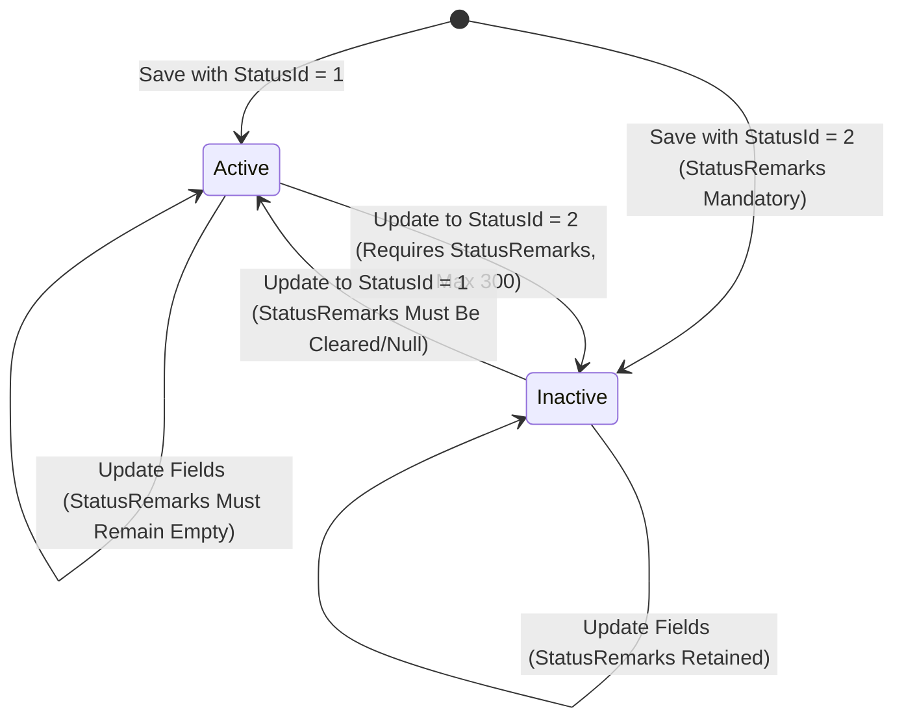
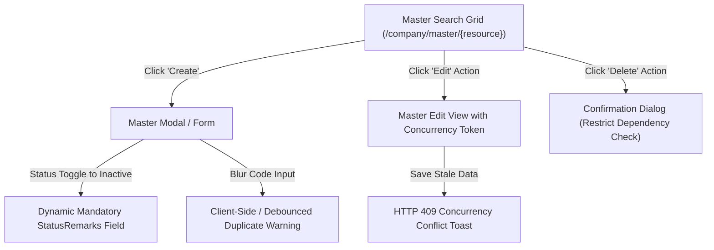

# Generic Master API & UI Test Specification Blueprint

> **Target Audience & Purpose:** Universal, production-grade test catalog and automation blueprint covering **all Master Forms** in the eProcurement platform (e.g., DocType, Division, Department, Location, Unit, CostCenter, Category, Group, Subgroup, Make, Priority, etc.).
> 
> **Architecture Baseline:** Conforms strictly to the **Division Master Reference Implementation Pattern**, `.NET 8 / C# 12 Primary Constructors`, `Clean Architecture`, `FluentValidation via Core.ValidatorMessage`, `MasterBaseModel / MasterBaseValidator`, `Error Management Constitution ({FORM_CODE}-{TYPE}-{NUMBER})`, and `OnDelete(DeleteBehavior.Restrict)`.
> 
> **Standard Request Headers:**
> - `Content-Type: application/json`
> - `Authorization: Bearer <jwt_token>`
> 
> **Coverage Scope:**
> - **Part 1: Backend REST API Validation** (Positive, Field Validation, Boundary/Overflow, Duplicate Business Rules, Status Lifecycle, Referential Integrity, Optimistic Concurrency, Hard Delete Restrictions, Paged Search & Sorting, Security & RBAC).
> - **Part 2: Frontend User Interface & Parity Verification** (Form Controls, Dynamic Conditional Rendering, Client Validations, Cascading Lookups, Grid/Table Sorting & Filtering, Concurrency Conflict Toasts, Confirmation Dialogs, Accessibility).
> - **Part 3: Master Data Seeding & Automation Mocks** (Reusable SQL seeding templates, JSON fixtures, Playwright TypeScript & C# patterns).

---

## 1. Master Architecture & Blueprint Parameterization

To adapt this generic specification to any specific master entity, substitute the template placeholders listed below:

### 1.1 Placeholder Substitution Matrix

| Placeholder | Meaning / Role | Example: Division Master | Example: DocType Master | Example: Department Master | Example: Location Master |
| :--- | :--- | :--- | :--- | :--- | :--- |
| `{Resource}` | Kebab-case API route plural | `divisions` | `doc-types` | `departments` | `locations` |
| `{ResourceSingular}` | PascalCase entity noun | `Division` | `DocType` | `Department` | `Location` |
| `{FormEnum}` | Platform Form Identifier | `FormEnum.Division` (`24`) | `FormEnum.DocType` (`26`) | `FormEnum.DepartmentMaster` (`27`) | `FormEnum.LocationMaster` (`18`) |
| `{ErrorFormCode}` | Centralized 5-letter Form Code | `PMDIV` | `PMDCT` | `PMDEP` | `PMLOC` |
| `{CodeField}` | Business identifier / code property | `Code` | `Code` | `Code` | `Code` |
| `{CodeMaxLength}` | Max length of Code field | `10` | `7` | `10` | `10` |
| `{NameField}` | Primary description / name property | `DivisionName` | `DocTypeName` | `DepartmentName` | `LocationName` |
| `{NameMaxLength}` | Max length of Name field | `100` | `100` | `100` | `100` |
| `{ParentField}` | Parent relational ID (if hierarchical) | `CompanyDetail` (M:N) | `CompanyDetails` (M:N) | N/A | `CityId` (Optional) |
| `{ChildEntity}` | Dependent entity blocking deletion | `PurchaseRequest`, `User` | `PurchaseRequest`, `Series` | `PurchaseRequest`, `User` | `CompanyLocation`, `Warehouse` |

---

## 2. API Contract & Response Envelope Standards

### 2.1 Success Response Envelope (`ApiResponse<MasterResponse>` / `ApiResponse<T>`)

```json
{
  "success": true,
  "responseType": 1, // 1 = MasterSave, 2 = MasterUpdate, 3 = MasterDelete
  "message": "Division Saved Successfully",
  "data": {
    "id": 101,
    "code": "DIV001",
    "name": "Manufacturing Division"
  }
}
```

### 2.2 Error Response Envelope (`ErrorResponse` per Error Management Constitution)

All error responses strictly obey the platform constitution:
```json
{
  "success": false,
  "error": {
    "code": "VALIDATION_ERROR", // VALIDATION_ERROR (400), UNAUTHORIZED (401), FORBIDDEN (403), NOT_FOUND (404), CONFLICT (409), BUSINESS_ERROR (422)
    "message": "Validation failed",
    "details": [
      {
        "field": "DivisionName",
        "message": "Division Name is required.",
        "errorCode": "PMDIV-VL-10002"
      }
    ],
    "traceId": "00-4bf92f3577b34da6a3ce929d0e0e4736-00"
  }
}
```

### 2.3 Error Code Range Convention
- **Validation (`VL`)**: `10000 - 19999` (e.g. `{FORM_CODE}-VL-10001` to `10015`)
- **Security (`SC`)**: `20000 - 29999` (e.g. `AUTH-SC-20001`, `RBAC-SC-20002`)
- **System / DB (`SY`)**: `30000 - 39999`
- **Infrastructure (`IN`)**: `40000 - 49999`
- **State / Concurrency (`SV`)**: `50000 - 59999` (e.g. `{FORM_CODE}-SV-50001`)
- **Business Rules (`BR`)**: `60000 - 69999` (e.g. `{FORM_CODE}-BR-60001` to `60012`)

---

## 3. Master Status Lifecycle Rules (`MasterBaseModel`)

All masters inherit from `MasterBaseModel` and enforce strict status transition invariants:



| `StatusId` | Status Meaning | `StatusRemarks` Requirement | Business Rule Enforcement |
| :---: | :--- | :--- | :--- |
| **`1`** | **Active** | **Must be empty / null** | Active master records appear in dropdown lookups (`/get`) and can be selected in transactions. |
| **`2`** | **Inactive** | **Mandatory** ($\le 300$ chars) | Inactive records are hidden from transaction lookups; existing historical transactions retain foreign key integrity. |

---

## 4. Master Standard Endpoints Under Test

| HTTP Method | Route | Description | Authorization & Guards |
| :--- | :--- | :--- | :--- |
| `POST` | `/api/master/{resource}` | Save new master record | `[Authorize]`, `[Rights(FormEnum, RightsEnum.Save)]` |
| `PUT` | `/api/master/{resource}/{id}` | Update existing record | `[Authorize]`, `[Rights(FormEnum, RightsEnum.Update)]` |
| `DELETE` | `/api/master/{resource}/{id}` | Hard delete master record | `[Authorize]`, `[Rights(FormEnum, RightsEnum.Delete)]` |
| `GET` | `/api/master/{resource}/{id}` | Get master by primary key | `[Authorize]`, `[VendorRestriction]` |
| `GET` | `/api/master/{resource}/get` | Active dropdown lookup list | `[Authorize]` |
| `GET` | `/api/master/{resource}` | Paged & sorted search grid | `[Authorize]`, `[Rights(FormEnum, RightsEnum.List)]` |
| `GET` | `/api/master/{resource}/next-code` | Auto-generate next sequence code | `[Authorize]`, `[VendorRestriction]` (where applicable) |

---

# Part 1: Backend REST API Test Specifications

---

## 5. Master API Test Execution Matrix Summary

| Test Case ID | HTTP Method | Endpoint | Scenario Category | Expected Status | Target Field / Assertion |
| :--- | :---: | :--- | :--- | :---: | :--- |
| `MST-POS-01` | `POST` | `/api/master/{resource}` | Happy Path | `200 OK` | Valid payload with Active status (`statusId: 1`), `statusRemarks: null` |
| `MST-POS-02` | `POST` | `/api/master/{resource}` | Happy Path | `200 OK` | Valid payload with Inactive status (`statusId: 2`), valid `statusRemarks` |
| `MST-POS-03` | `POST` | `/api/master/{resource}` | Happy Path | `200 OK` | Full optional fields & relational mappings populated |
| `MST-POS-04` | `POST` | `/api/master/{resource}` | Happy Path | `200 OK` | Auto-generated code handling via series / sequence |
| `MST-UPD-POS-01` | `PUT` | `/api/master/{resource}/{id}` | Happy Path | `200 OK` | Valid update with matching `lastModifiedDate` concurrency token |
| `MST-UPD-POS-02` | `PUT` | `/api/master/{resource}/{id}` | Happy Path | `200 OK` | State change: Active (`1`) $\to$ Inactive (`2`) with remarks added |
| `MST-UPD-POS-03` | `PUT` | `/api/master/{resource}/{id}` | Happy Path | `200 OK` | State change: Inactive (`2`) $\to$ Active (`1`) with remarks cleared |
| `MST-GET-POS-01` | `GET` | `/api/master/{resource}/{id}` | Query | `200 OK` | Retrieve existing record by ID, verifies complete view model |
| `MST-LKP-POS-01` | `GET` | `/api/master/{resource}/get` | Lookup | `200 OK` | Returns active records; verifies inactive records excluded |
| `MST-LKP-POS-02` | `GET` | `/api/master/{resource}/get` | Lookup | `200 OK` | Filter by `keywordSearch`, `companyId`, or parent relational ID |
| `MST-SRH-POS-01` | `GET` | `/api/master/{resource}` | Search / Grid | `200 OK` | Standard paged search (`pageNo: 1`, `pageSize: 10`) |
| `MST-SRH-POS-02` | `GET` | `/api/master/{resource}` | Search / Grid | `200 OK` | Sort ascending & descending on sortable metadata fields |
| `MST-DEL-POS-01` | `DELETE` | `/api/master/{resource}/{id}` | Deletion | `200 OK` | Hard delete record with zero relational dependencies |
| `MST-VAL-REQ-01` | `POST` | `/api/master/{resource}` | Field Validation | `400 Bad Request` | Missing or empty `{CodeField}` |
| `MST-VAL-REQ-02` | `POST` | `/api/master/{resource}` | Field Validation | `400 Bad Request` | Missing or empty `{NameField}` |
| `MST-VAL-REQ-03` | `POST` | `/api/master/{resource}` | Field Validation | `400 Bad Request` | Missing or zero `StatusId` (`statusId: 0` or negative) |
| `MST-VAL-FMT-01` | `POST` | `/api/master/{resource}` | Field Validation | `400 Bad Request` | `{CodeField}` contains special characters / non-alphanumeric |
| `MST-VAL-BND-01` | `POST` | `/api/master/{resource}` | Boundary | `400 Bad Request` | `{CodeField}` exceeds `{CodeMaxLength}` (e.g. length $+ 1$) |
| `MST-VAL-BND-02` | `POST` | `/api/master/{resource}` | Boundary | `200 OK` | `{CodeField}` at exact `{CodeMaxLength}` boundary |
| `MST-VAL-BND-03` | `POST` | `/api/master/{resource}` | Boundary | `400 Bad Request` | `{NameField}` exceeds `{NameMaxLength}` (e.g. length $+ 1$) |
| `MST-VAL-BND-04` | `POST` | `/api/master/{resource}` | Boundary | `200 OK` | `{NameField}` at exact `{NameMaxLength}` boundary |
| `MST-VAL-BND-05` | `POST` | `/api/master/{resource}` | Boundary | `400 Bad Request` | `StatusRemarks` exceeds 300 characters (301 chars) |
| `MST-BR-DUP-01` | `POST` | `/api/master/{resource}` | Business Rule | `400 Bad Request` | Duplicate `{CodeField}` within uniqueness scope |
| `MST-BR-DUP-02` | `POST` | `/api/master/{resource}` | Business Rule | `400 Bad Request` | Duplicate `{CodeField}` case-insensitive check (`div01` vs `DIV01`) |
| `MST-BR-DUP-03` | `POST` | `/api/master/{resource}` | Business Rule | `400 Bad Request` | Duplicate `{NameField}` within tenant / parent scope |
| `MST-BR-DUP-04` | `PUT` | `/api/master/{resource}/{id}` | Business Rule | `400 Bad Request` | Update `{NameField}` to another existing record's name |
| `MST-BR-DUP-05` | `PUT` | `/api/master/{resource}/{id}` | Business Rule | `200 OK` | Update record preserving its own existing Code & Name |
| `MST-BR-STS-01` | `POST` | `/api/master/{resource}` | Business Rule | `400 Bad Request` | Active status (`statusId: 1`) with non-empty `statusRemarks` |
| `MST-BR-STS-02` | `POST` | `/api/master/{resource}` | Business Rule | `400 Bad Request` | Inactive status (`statusId: 2`) with empty / null `statusRemarks` |
| `MST-BR-STS-03` | `POST` | `/api/master/{resource}` | Business Rule | `400 Bad Request` | Inactive status (`statusId: 2`) with whitespace-only `statusRemarks` |
| `MST-BR-REF-01` | `POST` | `/api/master/{resource}` | Business Rule | `400 Bad Request` | Reference to non-existent parent foreign key ID (`99999`) |
| `MST-BR-REF-02` | `POST` | `/api/master/{resource}` | Business Rule | `400 Bad Request` | Reference to Inactive parent master record |
| `MST-BR-REF-03` | `POST` | `/api/master/{resource}` | Business Rule | `400 Bad Request` | Duplicate child mappings in collection (e.g. duplicate CompanyId) |
| `MST-BR-LCK-01` | `PUT` | `/api/master/{resource}/{id}` | Business Rule | `400 Bad Request` | Changing `{CodeField}` when child dependencies exist |
| `MST-CON-01` | `PUT` | `/api/master/{resource}/{id}` | Concurrency | `400 Bad Request` | Missing `lastModifiedDate` in update request payload |
| `MST-CON-02` | `PUT` | `/api/master/{resource}/{id}` | Concurrency | `409 Conflict` | Stale `lastModifiedDate` (concurrency token mismatch) |
| `MST-DEL-ERR-01` | `DELETE` | `/api/master/{resource}/{id}` | Deletion Integrity | `404 Not Found` | Delete non-existent ID (`id: 99999`) |
| `MST-DEL-ERR-02` | `DELETE` | `/api/master/{resource}/{id}` | Deletion Integrity | `400 / 409 / 500` | Delete blocked by foreign key restriction (`Restrict` rule) |
| `MST-SRH-VAL-01` | `GET` | `/api/master/{resource}` | Grid Validation | `400 Bad Request` | Invalid sorting column name not in whitelist |
| `MST-SRH-VAL-02` | `GET` | `/api/master/{resource}` | Grid Validation | `400 Bad Request` | Invalid sorting direction (neither `asc` nor `desc`) |
| `MST-SRH-VAL-03` | `GET` | `/api/master/{resource}` | Grid Validation | `400 Bad Request` | `pageNo <= 0` or `pageSize <= 0` |
| `MST-SEC-01` | `POST` | `/api/master/{resource}` | Security | `401 Unauthorized` | Request executed without JWT Authorization header |
| `MST-SEC-02` | `POST` | `/api/master/{resource}` | Security | `403 Forbidden` | Authenticated user lacking `RightsEnum.Save` |
| `MST-SEC-03` | `PUT` | `/api/master/{resource}/{id}` | Security | `403 Forbidden` | Authenticated user lacking `RightsEnum.Update` |
| `MST-SEC-04` | `DELETE` | `/api/master/{resource}/{id}` | Security | `403 Forbidden` | Authenticated user lacking `RightsEnum.Delete` |
| `MST-SEC-05` | `GET` | `/api/master/{resource}/{id}` | Security | `403 Forbidden` | External supplier role blocked by `[VendorRestriction]` |

---

## 6. Detailed Test Cases by Functional Category

### 6.1 Positive / Happy Path Scenarios

#### `MST-POS-01`: Save Master with Active Status
- **Method & Route:** `POST /api/master/{resource}`
- **Description:** Verify that an authorized user can successfully create a new master record with Active status (`StatusId = 1`) and null status remarks.
- **Preconditions:** Parent entities (if required) exist and are Active.
- **Request Payload:**
```json
{
  "code": "MST01",
  "name": "Standard Operational Master",
  "statusId": 1,
  "statusRemarks": null
}
```
- **Expected Status:** `200 OK`
- **Expected Assertions:**
  - `success` equals `true`
  - `responseType` equals `1` (`MasterSave`)
  - `data.id` is a positive integer (`> 0`)
  - `data.code` equals `"MST01"`
  - Database verification: record persisted with `StatusId = 1`, `CreatedDate` stamped, `CreatedById` matching authenticated user.
- **Playwright Test Pattern:**
```typescript
const response = await request.post('/api/master/divisions', {
  headers: { 'Authorization': `Bearer ${adminToken}` },
  data: {
    code: 'DIV01',
    divisionName: 'Engineering Division',
    statusId: 1,
    statusRemarks: null,
    companyDetail: [{ companyId: 1, statusId: 1 }]
  }
});
expect(response.status()).toBe(200);
const body = await response.json();
expect(body.success).toBe(true);
expect(body.data.id).toBeGreaterThan(0);
```

---

#### `MST-POS-02`: Save Master with Inactive Status & Mandatory Remarks
- **Method & Route:** `POST /api/master/{resource}`
- **Description:** Verify saving a new master record initialized directly as Inactive (`StatusId = 2`), accompanied by mandatory justification in `statusRemarks`.
- **Request Payload:**
```json
{
  "code": "MST02",
  "name": "Legacy Master Item",
  "statusId": 2,
  "statusRemarks": "Created as inactive pending regulatory licensing"
}
```
- **Expected Status:** `200 OK`
- **Expected Assertions:**
  - `success` equals `true`
  - `data.id > 0`
  - Database verification: `StatusId == 2`, `StatusRemarks` matches payload.

---

#### `MST-UPD-POS-01`: Update Master with Concurrency Token
- **Method & Route:** `PUT /api/master/{resource}/{id}`
- **Description:** Update editable master attributes using the exact `lastModifiedDate` timestamp obtained from the preceding GET/Search response.
- **Preconditions:** Master record exists (`id: 101`) with known `lastModifiedDate`.
- **Request Payload:**
```json
{
  "code": "MST01",
  "name": "Updated Operational Master Name",
  "statusId": 1,
  "statusRemarks": null,
  "lastModifiedDate": "2026-11-20T10:15:30.1234567+00:00"
}
```
- **Expected Status:** `200 OK`
- **Expected Assertions:**
  - `success` equals `true`
  - `responseType` equals `2` (`MasterUpdate`)
  - Database verification: `Name` updated, `ModifiedDate` updated to new timestamp, `ModifiedById` recorded.

---

#### `MST-UPD-POS-02`: State Transition from Active to Inactive
- **Method & Route:** `PUT /api/master/{resource}/{id}`
- **Description:** Transition an active master to inactive. Verifies that supplying `statusRemarks` satisfies domain requirements.
- **Request Payload:**
```json
{
  "code": "MST01",
  "name": "Standard Operational Master",
  "statusId": 2,
  "statusRemarks": "Department operations merged into central division",
  "lastModifiedDate": "2026-11-20T10:15:30.1234567+00:00"
}
```
- **Expected Status:** `200 OK`
- **Expected Assertions:**
  - `success` equals `true`
  - Subsequent call to `/api/master/{resource}/get` **excludes** this ID from dropdown results.

---

#### `MST-UPD-POS-03`: State Transition from Inactive to Active
- **Method & Route:** `PUT /api/master/{resource}/{id}`
- **Description:** Reactivate an inactive master record. In accordance with `MasterBaseModel` conventions, `statusRemarks` must be cleared (`null` or `""`).
- **Request Payload:**
```json
{
  "code": "MST01",
  "name": "Standard Operational Master",
  "statusId": 1,
  "statusRemarks": null,
  "lastModifiedDate": "2026-11-20T11:20:00.0000000+00:00"
}
```
- **Expected Status:** `200 OK`
- **Expected Assertions:**
  - `success` equals `true`
  - Database verification: `StatusId == 1`, `StatusRemarks == null`.

---

#### `MST-DEL-POS-01`: Hard Delete Master with Zero Dependencies
- **Method & Route:** `DELETE /api/master/{resource}/{id}`
- **Description:** Permanently remove a master record that has never been linked to child masters or transactions.
- **Preconditions:** Clean master record (`id: 105`) exists with 0 foreign key references.
- **Expected Status:** `200 OK`
- **Expected Assertions:**
  - `success` equals `true`
  - `responseType` equals `3` (`MasterDelete`)
  - Subsequent `GET /api/master/{resource}/105` returns `404 Not Found`.

---

### 6.2 Field-Level Validation & Type Enforcements (`VL-10000..19999`)

#### `MST-VAL-REQ-01`: Missing or Empty `{CodeField}`
- **Method & Route:** `POST /api/master/{resource}`
- **Test Scenarios:**
  1. `{CodeField}` omitted from payload.
  2. `{CodeField}` passed as empty string `""`.
  3. `{CodeField}` passed as whitespace `"   "`.
- **Expected Status:** `400 Bad Request`
- **Expected Response:**
```json
{
  "success": false,
  "error": {
    "code": "VALIDATION_ERROR",
    "message": "Validation failed",
    "details": [
      {
        "field": "Code",
        "message": "Code is required.",
        "errorCode": "{FORM_CODE}-VL-10001"
      }
    ]
  }
}
```

---

#### `MST-VAL-REQ-02`: Missing or Empty `{NameField}`
- **Method & Route:** `POST /api/master/{resource}`
- **Test Scenarios:** `{NameField}` missing, `null`, `""`, or `"   "`.
- **Expected Status:** `400 Bad Request`
- **Expected Response:**
```json
{
  "success": false,
  "error": {
    "code": "VALIDATION_ERROR",
    "message": "Validation failed",
    "details": [
      {
        "field": "{NameField}",
        "message": "{NameField} is required.",
        "errorCode": "{FORM_CODE}-VL-10002"
      }
    ]
  }
}
```

---

#### `MST-VAL-REQ-03`: Invalid or Zero `StatusId`
- **Method & Route:** `POST /api/master/{resource}`
- **Test Scenarios:**
  - `statusId: 0`
  - `statusId: -1`
  - `statusId: 99` (non-existent enum value)
- **Expected Status:** `400 Bad Request`
- **Expected Response:**
  - Details identify `StatusId` as invalid / out of range.

---

#### `MST-VAL-FMT-01`: `{CodeField}` Regex & Formatting Violation
- **Method & Route:** `POST /api/master/{resource}`
- **Description:** Many masters (e.g. Division, DocType, Unit) enforce alphanumeric codes (`^[a-zA-Z0-9]+$`).
- **Payload:** `{"code": "DIV@01#", "name": "Invalid Code Format", "statusId": 1}`
- **Expected Status:** `400 Bad Request`
- **Expected Response:**
  - Error message: `"Code must contain only letters and numbers."`

---

### 6.3 Boundary Limits & Data Length Validations

#### Boundary Analysis Matrix

| Field | Min Length Rule | Exact Max Limit | Tested Boundary Values | Expected Result |
| :--- | :---: | :---: | :--- | :--- |
| **`Code`** | 1 character | `{CodeMaxLength}` (e.g. 10) | • Length = 1: `"A"`<br/>• Length = 10: `"ABCDEFGHIJ"`<br/>• Length = 11: `"ABCDEFGHIJK"` | • Length 1: `200 OK`<br/>• Length 10: `200 OK`<br/>• Length 11: `400 Bad Request` |
| **`Name`** | 1 character | `{NameMaxLength}` (e.g. 100) | • Length = 1: `"X"`<br/>• Length = 100: string of 100 chars<br/>• Length = 101: string of 101 chars | • Length 1: `200 OK`<br/>• Length 100: `200 OK`<br/>• Length 101: `400 Bad Request` |
| **`StatusRemarks`** | 1 character | 300 characters | • Length = 1: `"R"`<br/>• Length = 300: string of 300 chars<br/>• Length = 301: string of 301 chars | • Length 1: `200 OK` (when Inactive)<br/>• Length 300: `200 OK`<br/>• Length 301: `400 Bad Request` |

#### `MST-VAL-BND-01`: `{CodeField}` Max Length $+ 1$ Overflow
- **Method & Route:** `POST /api/master/{resource}`
- **Payload:** `{CodeField}` containing `{CodeMaxLength} + 1` characters.
- **Expected Status:** `400 Bad Request`
- **Expected Message:** `"{CodeField} cannot exceed {CodeMaxLength} characters."`

#### `MST-VAL-BND-03`: `{NameField}` Max Length $+ 1$ Overflow
- **Method & Route:** `POST /api/master/{resource}`
- **Payload:** `{NameField}` containing `{NameMaxLength} + 1` characters.
- **Expected Status:** `400 Bad Request`
- **Expected Message:** `"{NameField} cannot be more than {NameMaxLength} characters."`

#### `MST-VAL-BND-05`: `StatusRemarks` Overflow (> 300 characters)
- **Method & Route:** `POST /api/master/{resource}`
- **Payload:** `{"statusId": 2, "statusRemarks": "A...[301 chars]..."}`
- **Expected Status:** `400 Bad Request`
- **Expected Message:** `"Status remarks must not exceed 300 characters."`

---

### 6.4 Business Rules & Uniqueness Validations (`BR-60000..69999`)

#### `MST-BR-DUP-01`: Duplicate Code Prohibition
- **Method & Route:** `POST /api/master/{resource}`
- **Preconditions:** A master record already exists with code `"CODE01"`.
- **Payload:** `{"code": "CODE01", "name": "Different Name", "statusId": 1}`
- **Expected Status:** `400 Bad Request`
- **Expected Error:**
```json
{
  "field": "Code",
  "message": "Duplicate Code not allowed.",
  "errorCode": "{FORM_CODE}-BR-60001"
}
```

---

#### `MST-BR-DUP-02`: Duplicate Code Case-Insensitive Matching
- **Method & Route:** `POST /api/master/{resource}`
- **Preconditions:** Record exists with code `"CODE01"`.
- **Payload:** `{"code": "code01", "name": "Different Name", "statusId": 1}`
- **Expected Status:** `400 Bad Request`
- **Assertion:** Uniqueness verification must be case-insensitive (e.g. `UPPER(TRIM(code))`).

---

#### `MST-BR-DUP-03`: Duplicate Name Prohibition
- **Method & Route:** `POST /api/master/{resource}`
- **Preconditions:** Record exists with name `"Corporate Division"`.
- **Payload:** `{"code": "NEW01", "name": "corporate division", "statusId": 1}`
- **Expected Status:** `400 Bad Request`
- **Expected Error:**
```json
{
  "field": "DivisionName",
  "message": "Duplicate Division Name not allowed.",
  "errorCode": "{FORM_CODE}-BR-60002"
}
```

---

#### `MST-BR-DUP-04`: Update Conflict with Another Record's Name
- **Method & Route:** `PUT /api/master/{resource}/{id}`
- **Preconditions:** Record A has Name `"Alpha"`. Record B (`id: 2`) has Name `"Beta"`.
- **Action:** Attempt to update Record B's name to `"Alpha"`.
- **Expected Status:** `400 Bad Request`
- **Assertion:** Rejects update; names must be unique across all active/inactive master entries.

---

#### `MST-BR-DUP-05`: Update Record Preserving Existing Code & Name
- **Method & Route:** `PUT /api/master/{resource}/{id}`
- **Preconditions:** Record (`id: 101`) has Code `"DIV01"` and Name `"Production"`.
- **Action:** Update record keeping Code `"DIV01"` and Name `"Production"`, modifying only optional fields or status.
- **Expected Status:** `200 OK`
- **Assertion:** The duplicate check excludes the current record (`x.Id != currentId`).

---

#### `MST-BR-STS-01`: Active Status with Non-Empty Remarks
- **Method & Route:** `POST /api/master/{resource}`
- **Payload:** `{"code": "MST01", "name": "Test", "statusId": 1, "statusRemarks": "Remarks provided for active"}`
- **Expected Status:** `400 Bad Request`
- **Expected Error:** `"Status remarks must be empty when status is Active."`

---

#### `MST-BR-STS-02`: Inactive Status with Missing Remarks
- **Method & Route:** `POST /api/master/{resource}`
- **Payload:** `{"code": "MST01", "name": "Test", "statusId": 2, "statusRemarks": null}`
- **Expected Status:** `400 Bad Request`
- **Expected Error:** `"Status remarks are required when status is Inactive."`

---

#### `MST-BR-REF-01`: Non-Existent Parent Relational Entity
- **Method & Route:** `POST /api/master/{resource}`
- **Description:** When the master contains foreign keys or child mapping details (e.g. `CompanyId: 99999` in Division or DocType).
- **Expected Status:** `400 Bad Request`
- **Expected Error:** `"Company is Invalid or Inactive."` or `"Company not found."`

---

#### `MST-BR-REF-02`: Inactive Parent Relational Entity
- **Method & Route:** `POST /api/master/{resource}`
- **Description:** Referencing a parent entity whose `StatusId == 2` (Inactive).
- **Expected Status:** `400 Bad Request`
- **Expected Error:** Rejects mapping to inactive parent; masters cannot attach to inactive parents.

---

#### `MST-BR-LCK-01`: Mutation Lock on Code When Children/Transactions Exist
- **Method & Route:** `PUT /api/master/{resource}/{id}`
- **Preconditions:** Master record (`id: 101`) has child entities (e.g. Category has Groups, or Division has Purchase Requests).
- **Action:** Attempt to mutate `code` from `"DIV01"` to `"DIV99"`.
- **Expected Status:** `400 Bad Request`
- **Expected Error:** `"Cannot update the Code if the {Resource} is associated with transactions or child records."`

---

### 6.5 Optimistic Concurrency & State Mutation

#### `MST-CON-01`: Missing Concurrency Token on PUT
- **Method & Route:** `PUT /api/master/{resource}/{id}`
- **Payload:** Valid fields, but `lastModifiedDate` property omitted.
- **Expected Status:** `400 Bad Request`
- **Expected Error:** `"LastModifiedDate is required."`

---

#### `MST-CON-02`: Stale Concurrency Token (Conflict Detection)
- **Method & Route:** `PUT /api/master/{resource}/{id}`
- **Preconditions:**
  1. User A fetches Master record at `T0` (`lastModifiedDate: 2026-11-20T10:00:00Z`).
  2. User B updates the record at `T1` (`lastModifiedDate` advances to `2026-11-20T10:05:00Z`).
  3. User A submits update at `T2` using stale token from `T0`.
- **Expected Status:** `409 Conflict`
- **Expected Response Envelope:**
```json
{
  "success": false,
  "error": {
    "code": "CONFLICT",
    "message": "The record has been modified by another user. Please reload the latest data and try again."
  }
}
```

---

### 6.6 Referential Integrity & Hard Deletion Rules

#### `MST-DEL-ERR-01`: Delete Non-Existent Master Record
- **Method & Route:** `DELETE /api/master/{resource}/99999`
- **Expected Status:** `404 Not Found`
- **Expected Message:** `"{Resource} not found."`

---

#### `MST-DEL-ERR-02`: Delete Blocked by Foreign Key Dependency
- **Method & Route:** `DELETE /api/master/{resource}/{id}`
- **Preconditions:** Master record (`id: 101`) is referenced by $\ge 1$ transactional record (e.g., Purchase Request, RFQ, PO) or dependent master.
- **Underlying EF Core Rule:** `.OnDelete(DeleteBehavior.Restrict)`.
- **Expected Status:** `400 Bad Request` / `409 Conflict` (or handled DB foreign key constraint violation).
- **Expected Message:** `"Cannot delete {Resource} because dependent records exist."`

---

### 6.7 Query, Dropdown Lookups & Search Pagination

#### `MST-LKP-POS-01`: Active Dropdown Lookup List
- **Method & Route:** `GET /api/master/{resource}/get`
- **Description:** Lightweight endpoint used to populate UI selects/comboboxes.
- **Expected Assertions:**
  - Returns array of `{ id, code, name }`.
  - Only records with `statusId == 1` (Active) are returned.
  - Inactive records (`statusId == 2`) are strictly filtered out.

---

#### `MST-LKP-POS-02`: Dropdown Filter by Parent / Keyword
- **Method & Route:** `GET /api/master/{resource}/get?keywordSearch=eng&companyId=1`
- **Expected Assertions:**
  - Returns matching records where `code` or `name` contains `"eng"` (case-insensitive).
  - Only records belonging to `companyId = 1` returned.

---

#### `MST-SRH-POS-01`: Paged Search Execution
- **Method & Route:** `GET /api/master/{resource}?pageNo=1&pageSize=10`
- **Expected Response Envelope:**
```json
{
  "totalCount": 45,
  "pageNo": 1,
  "pageSize": 10,
  "items": [
    {
      "id": 101,
      "code": "DIV01",
      "name": "Engineering Division",
      "status": {
        "id": 1,
        "statusName": "Active"
      },
      "createdDate": "2026-11-01T08:00:00Z",
      "createdBy": {
        "id": 1,
        "userName": "admin",
        "displayName": "System Admin"
      }
    }
  ]
}
```

---

#### `MST-SRH-POS-02`: Sorting on Whitelisted Columns
- **Method & Route:** `GET /api/master/{resource}?sorting=name asc` & `?sorting=name desc`
- **Expected Assertions:**
  - `sorting=name asc`: Items returned in alphabetical ascending order by Name.
  - `sorting=name desc`: Items returned in alphabetical descending order.
  - Case-insensitive sortable metadata mapping.

---

#### `MST-SRH-VAL-01`: Invalid Sorting Field Injection
- **Method & Route:** `GET /api/master/{resource}?sorting=password desc`
- **Expected Status:** `400 Bad Request`
- **Expected Error:** `"Invalid sortable field: password."`

---

### 6.8 Security, RBAC & Vendor Restriction

#### `MST-SEC-01`: Anonymous Invocation Blocked
- **Method & Route:** `POST /api/master/{resource}` (without `Authorization` header)
- **Expected Status:** `401 Unauthorized`

---

#### `MST-SEC-02`: Role-Based Access Control - Save Denied
- **Method & Route:** `POST /api/master/{resource}` with JWT of user lacking `RightsEnum.Save` for this form.
- **Expected Status:** `403 Forbidden`

---

#### `MST-SEC-04`: Role-Based Access Control - Delete Denied
- **Method & Route:** `DELETE /api/master/{resource}/{id}` with JWT of user lacking `RightsEnum.Delete`.
- **Expected Status:** `403 Forbidden`

---

#### `MST-SEC-05`: External Vendor Role Restriction
- **Method & Route:** `GET /api/master/{resource}/{id}`
- **Context:** Endpoint decorated with `[VendorRestriction]`.
- **User:** Authenticated external supplier/vendor account.
- **Expected Status:** `403 Forbidden`
- **Expected Message:** External vendor users are prevented from accessing internal master administration APIs.

---

# Part 2: Frontend User Interface & Parity Verification

---

## 7. Frontend UI Test Cases Matrix



| UI Test ID | Target Component | Action / Event | Expected User Interface Behavior |
| :--- | :--- | :--- | :--- |
| `UI-MST-NAV-01` | Side Navigation | Click `{MasterName}` Menu Item | Navigates to `/company/master/{resource}`; breadcrumbs render `Home > Masters > {MasterName}`. |
| `UI-MST-GRD-01` | Master Grid Table | Initial Page Load | Skeleton loader displays; renders paged table, column headers, status badges, and action buttons. |
| `UI-MST-GRD-02` | Search Input | Type query with debounce | Debounces 300ms; triggers API search; updates table rows; preserves active page or resets to Page 1. |
| `UI-MST-GRD-03` | Column Header | Click sortable header (Code/Name) | Toggles sorting indicator ($\uparrow$ / $\downarrow$); refreshes grid data matching sort direction. |
| `UI-MST-GRD-04` | Pagination Bar | Change page size from 10 to 25 | Grid re-fetches with `pageSize=25`; row count reflects choice; total count indicator remains accurate. |
| `UI-MST-FRM-01` | Create Modal/Form | Click `+ Add New` Button | Opens modal/drawer; focuses Code field; sets Status default to `Active (1)`; disables Remarks field. |
| `UI-MST-FRM-02` | Form Inputs | Field Labels & Asterisks | Mandatory fields (`Code`, `Name`, `Status`) display red asterisk (`*`); optional fields have no asterisk. |
| `UI-MST-FRM-03` | Status Dropdown | Switch Status from `Active` to `Inactive` | `Status Remarks` textarea immediately becomes enabled / visible with red mandatory asterisk (`*`). |
| `UI-MST-FRM-04` | Status Dropdown | Switch Status from `Inactive` to `Active` | `Status Remarks` textarea is cleared, disabled, and red asterisk removed. |
| `UI-MST-FRM-05` | Code Input | Type lowercase alphanumeric | Auto-transforms to UPPERCASE or retains clean input; rejects special characters ($@\#\$\%*$). |
| `UI-MST-FRM-06` | Code Input | Input length restriction | `maxlength="{CodeMaxLength}"` enforced by input element; stops further character entry. |
| `UI-MST-FRM-07` | Name Input | Input length restriction | `maxlength="{NameMaxLength}"` enforced by input element; displays character counter if configured. |
| `UI-MST-FRM-08` | Form Submission | Click `Save` with empty fields | Prevents API call; highlights invalid fields in red; displays inline helper text (`"Code is required"`). |
| `UI-MST-FRM-09` | Form Submission | Valid inputs submission | Disables `Save` button (spinner state); invokes POST API; shows green success toast; closes modal; refreshes grid. |
| `UI-MST-EDT-01` | Grid Row Action | Click `Edit` (Pencil Icon) | Opens Edit modal; pre-populates all fields; caches `lastModifiedDate`; locks Code if dependencies exist. |
| `UI-MST-EDT-02` | Edit Form | Save with Concurrency Conflict | If another user saved changes, displays warning dialog: *"Data has changed. Click Reload to refresh."* |
| `UI-MST-DEL-01` | Grid Row Action | Click `Delete` (Trash Icon) | Opens modal: *"Are you sure you want to delete {Code}?"* with `Cancel` and red `Confirm Delete` buttons. |
| `UI-MST-DEL-02` | Delete Modal | Confirm delete when linked to PR/PO | API returns error; UI displays red alert: *"Cannot delete record because dependent transactions exist."* |
| `UI-MST-DEL-03` | Delete Modal | Confirm delete with clean record | Record deleted; green toast: *"Record deleted successfully"*; row animated out from table. |
| `UI-MST-A11Y-01` | Form Dialog | Keyboard Navigation (A11y) | `Tab` cycles through inputs in logical order; `Enter` submits form; `Escape` closes modal with dirty confirmation. |

---

## 8. Detailed UI Scenario Specifications

### 8.1 Status Remarks Dynamic Field Parity (`UI-MST-FRM-03` & `04`)
- **Objective:** Ensure complete parity between frontend UI conditional display and backend `MasterBaseValidator` rules.
- **Execution Steps:**
  1. Open the Master Create modal. Observe `Status` dropdown defaults to `"Active"`.
  2. Observe the `Status Remarks` input field: it MUST be either **hidden** or **disabled** with no required asterisk (`*`).
  3. Change the `Status` select dropdown to `"Inactive"`.
  4. Verify:
     - `Status Remarks` field transitions to **visible and enabled**.
     - A red mandatory asterisk (`*`) appears next to the label `"Status Remarks"`.
     - Attempting to submit without entering remarks displays an inline error: `"Status remarks are required when status is Inactive."`
  5. Enter `"Temporary shutdown"` in remarks.
  6. Switch `Status` back to `"Active"`.
  7. Verify:
     - `Status Remarks` field is cleared (`""`) and disabled/hidden.
     - Required validation error disappears.

---

### 8.2 Client-Side Code Uppercase & Formatting Mask (`UI-MST-FRM-05`)
- **Objective:** Verify user input sanitization on identifier codes.
- **Execution Steps:**
  1. Focus the `Code` input field.
  2. Type: `div-01 @ tech`.
  3. Verify the field either restricts forbidden characters in real-time or auto-converts to `DIV01TECH` according to master specification.
  4. Verify leading and trailing spaces are trimmed automatically upon field blur.

---

### 8.3 Concurrency Conflict Toast & Modal Reload (`UI-MST-EDT-02`)
- **Objective:** Validate frontend graceful handling of HTTP 409 Conflict.
- **Execution Steps:**
  1. Open Edit modal for Master Record `Id: 101` in Browser Window A.
  2. In Browser Window B (or via Postman), submit a PUT request updating Master Record `Id: 101`.
  3. Return to Browser Window A. Click `Save Changes`.
  4. The API returns `409 Conflict`.
  5. Verify:
     - Form does **NOT** silently fail or close.
     - A prominent warning banner/toast appears: *"Conflict: This record was modified by another session. Please reload to see the latest changes."*
     - A `Reload` button is provided that fetches fresh data and updates `lastModifiedDate`.

---

# Part 3: Master Test Data Seeding & Automation Mocks

---

## 9. Reusable Database Seeding Scripts

### 9.1 Standard Master SQL Seeding Template

Use this script to populate a complete test fixture with active, inactive, boundary, and linked master records:

```sql
-- ============================================================================
-- MASTER GENERIC SEED FIXTURE
-- Substitutions: Table -> [master_table], CodeCol -> [code], NameCol -> [name]
-- ============================================================================

-- 1. Insert Standard Active Master (Clean, 0 Dependencies)
INSERT INTO master_table (code, name, status_id, status_remarks, created_date, created_by_id, modified_date, modified_by_id)
VALUES ('MST-ACT-01', 'Active Production Master', 1, NULL, CURRENT_TIMESTAMP, 1, CURRENT_TIMESTAMP, 1);

-- 2. Insert Standard Inactive Master
INSERT INTO master_table (code, name, status_id, status_remarks, created_date, created_by_id, modified_date, modified_by_id)
VALUES ('MST-INA-01', 'Inactive Archived Master', 2, 'Archived during 2025 organizational restructuring', CURRENT_TIMESTAMP, 1, CURRENT_TIMESTAMP, 1);

-- 3. Insert Boundary Master (Exact Max Length Code & Name)
INSERT INTO master_table (code, name, status_id, status_remarks, created_date, created_by_id, modified_date, modified_by_id)
VALUES ('MAXCODE10', 'Exact 100 Character Name Padding XXXXXXXXXXXXXXXXXXXXXXXXXXXXXXXXXXXXXXXXXXXXXXXXXXXXXXXXXXXXXXX01', 1, NULL, CURRENT_TIMESTAMP, 1, CURRENT_TIMESTAMP, 1);

-- 4. Insert Master with Dependent Transaction (Locked from Deletion & Code Mutation)
INSERT INTO master_table (code, name, status_id, status_remarks, created_date, created_by_id, modified_date, modified_by_id)
VALUES ('MST-LCK-01', 'Locked Master Linked to PR', 1, NULL, CURRENT_TIMESTAMP, 1, CURRENT_TIMESTAMP, 1);

-- Link to transaction (Example: Purchase Request)
-- INSERT INTO purchase_requests (..., master_id) VALUES (..., (SELECT id FROM master_table WHERE code = 'MST-LCK-01'));
```

---

## 10. Reusable JSON Test Fixtures

### 10.1 Valid Save Payload (`payload-master-save-valid.json`)
```json
{
  "code": "DIV001",
  "name": "Heavy Manufacturing Division",
  "statusId": 1,
  "statusRemarks": null
}
```

### 10.2 Valid Inactive Save Payload (`payload-master-save-inactive.json`)
```json
{
  "code": "DIV002",
  "name": "Decommissioned Plant Division",
  "statusId": 2,
  "statusRemarks": "Plant operations ceased in Q3 2026"
}
```

### 10.3 Valid Update Payload with Concurrency Token (`payload-master-update-valid.json`)
```json
{
  "code": "DIV001",
  "name": "Heavy Manufacturing & Assembly Division",
  "statusId": 1,
  "statusRemarks": null,
  "lastModifiedDate": "2026-11-21T09:30:00.0000000+00:00"
}
```

### 10.4 Invalid Payload - Missing Mandatory Fields (`payload-master-save-invalid.json`)
```json
{
  "code": "",
  "name": "   ",
  "statusId": 0,
  "statusRemarks": null
}
```

---

## 11. Automated Test Automation Code Snippets

### 11.1 Playwright API Test Suite Template (TypeScript)

```typescript
import { test, expect, APIRequestContext } from '@playwright/test';

test.describe('Generic Master API Automated Test Suite', () => {
  const resource = 'divisions'; // Substitute with target master resource
  const formCode = 'PMDIV';     // Substitute with target ErrorFormCode
  let authToken: string;
  let createdId: number;
  let concurrencyToken: string;

  test.beforeAll(async ({ request }) => {
    // Authenticate and obtain JWT
    const loginRes = await request.post('/api/auth/login', {
      data: { username: 'admin', password: 'Password123!' }
    });
    const loginData = await loginRes.json();
    authToken = loginData.data.token;
  });

  test('MST-POS-01: Create Master Record with Active Status', async ({ request }) => {
    const payload = {
      code: `MST${Date.now().toString().slice(-4)}`,
      divisionName: 'Automated Test Division',
      statusId: 1,
      statusRemarks: null,
      companyDetail: [{ companyId: 1, statusId: 1 }]
    };

    const res = await request.post(`/api/master/${resource}`, {
      headers: { 'Authorization': `Bearer ${authToken}` },
      data: payload
    });

    expect(res.status()).toBe(200);
    const body = await res.json();
    expect(body.success).toBe(true);
    expect(body.responseType).toBe(1); // MasterSave
    expect(body.data.id).toBeGreaterThan(0);
    createdId = body.data.id;
  });

  test('MST-CON-02: Stale Concurrency Token returns 409 Conflict', async ({ request }) => {
    // 1. Fetch current record
    const getRes = await request.get(`/api/master/${resource}/${createdId}`, {
      headers: { 'Authorization': `Bearer ${authToken}` }
    });
    const record = await getRes.json();
    concurrencyToken = record.data.lastModifiedDate;

    // 2. Perform intermediate update to advance timestamp
    await request.put(`/api/master/${resource}/${createdId}`, {
      headers: { 'Authorization': `Bearer ${authToken}` },
      data: { ...record.data, divisionName: 'Interim Update' }
    });

    // 3. Attempt update with now-stale concurrencyToken
    const conflictRes = await request.put(`/api/master/${resource}/${createdId}`, {
      headers: { 'Authorization': `Bearer ${authToken}` },
      data: {
        ...record.data,
        divisionName: 'Conflicting Name',
        lastModifiedDate: concurrencyToken
      }
    });

    expect(conflictRes.status()).toBe(409);
  });

  test('MST-BR-STS-01: Active Status with Remarks returns 400 Bad Request', async ({ request }) => {
    const res = await request.post(`/api/master/${resource}`, {
      headers: { 'Authorization': `Bearer ${authToken}` },
      data: {
        code: 'ERR01',
        divisionName: 'Invalid Remarks Division',
        statusId: 1,
        statusRemarks: 'Remarks not permitted for Active'
      }
    });

    expect(res.status()).toBe(400);
    const body = await res.json();
    expect(body.success).toBe(false);
    expect(body.error.details.some(d => d.message.includes('must be empty'))).toBe(true);
  });
});
```

---

### 11.2 Playwright UI End-to-End Test Suite Template (TypeScript)

```typescript
import { test, expect } from '@playwright/test';

test.describe('Generic Master UI Form & Grid E2E Suite', () => {
  const masterUrl = '/company/master/division';

  test.beforeEach(async ({ page }) => {
    // Perform UI login session or restore storageState
    await page.goto('/auth/login');
    await page.fill('input[name="username"]', 'admin');
    await page.fill('input[name="password"]', 'Password123!');
    await page.click('button[type="submit"]');
    await page.waitForURL('/dashboard');
    await page.goto(masterUrl);
  });

  test('UI-MST-FRM-03/04: Verify Dynamic Status Remarks Visibility', async ({ page }) => {
    // Open create modal
    await page.click('button:has-text("Add Division")');
    await expect(page.locator('.modal-content')).toBeVisible();

    // Verify Active status defaults Remarks to hidden/disabled
    const statusSelect = page.locator('select[name="statusId"]');
    const remarksField = page.locator('textarea[name="statusRemarks"]');
    
    await expect(statusSelect).toHaveValue('1');
    await expect(remarksField).toBeDisabled();

    // Change status to Inactive (2)
    await statusSelect.selectOption('2');
    await expect(remarksField).toBeEnabled();
    await expect(page.locator('label[for="statusRemarks"] span.required')).toBeVisible();

    // Attempt Save without remarks -> verifies inline error
    await page.click('button:has-text("Save")');
    await expect(page.locator('.field-error:has-text("Status Remarks is required")')).toBeVisible();

    // Revert status to Active (1) -> verifies field disabled and error cleared
    await statusSelect.selectOption('1');
    await expect(remarksField).toBeDisabled();
    await expect(page.locator('.field-error:has-text("Status Remarks is required")')).not.toBeVisible();
  });

  test('UI-MST-GRD-02: Debounced Search Grid Filtering', async ({ page }) => {
    const searchInput = page.locator('input[placeholder*="Search"]');
    await searchInput.fill('Manufacturing');
    
    // Wait for 300ms debounce and network idle
    await page.waitForResponse(resp => resp.url().includes('/api/master/divisions') && resp.status() === 200);

    // Verify grid rows reflect filtered results
    const rows = page.locator('table.master-grid tbody tr');
    await expect(rows.first()).toContainText('Manufacturing');
  });
});
```

---

## 12. How to Adapt this Generic Specification for a New Master

Follow this step-by-step checklist when authoring a new master specification:

1. **Identify the Form Identifiers**:
   - Locate `FormEnum.{MasterName}` in `Core/Enumeration/FormEnum.cs`.
   - Locate `ErrorFormCode.{MasterName}` in `Core/Errors/ErrorFormCode.cs`.
2. **Review Model & Validator Classes**:
   - Open `Api/Models/Master/{MasterName}Model.cs` and `Api/ModelValidators/Master/{MasterName}ModelValidator.cs`.
   - Extract exact field names, max string lengths, and custom regex expressions.
3. **Inspect Core Service Business Rules**:
   - Open `Core/Services/Master/{MasterName}CoreService.cs`.
   - Identify custom uniqueness constraints (`CheckDuplicateCode`, `CheckDuplicateName`), active parent checks, and deletion locks.
4. **Copy & Parameterize**:
   - Clone this template into `Documents/{MasterName}_Master_API_UI_Test_Cases.md`.
   - Run a search & replace using the **Placeholder Substitution Matrix** defined in Section 1.1.
5. **Add Master-Specific Relational Cases**:
   - If the master contains unique child grids (e.g. `CompanyDetails` in DocType or Division, or `CityId` in Location), append dedicated mapping validation tests (`MST-BR-REF-03`).
6. **Automate**:
   - Feed the resulting specification directly into Playwright API & UI test generators.
